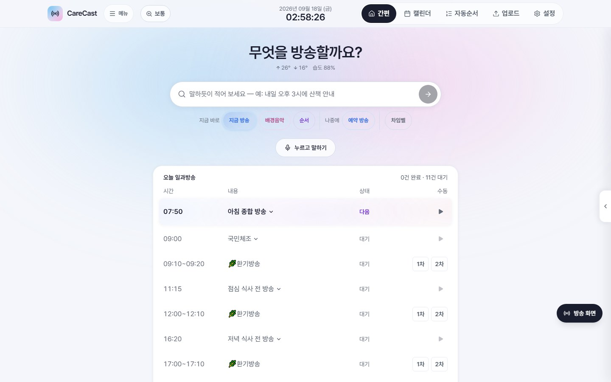
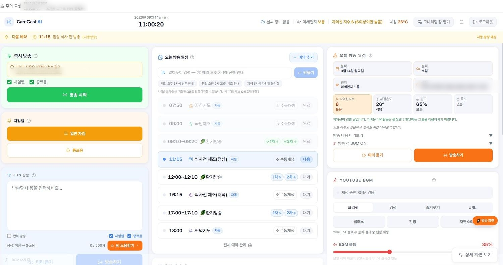

# **CareCast — 기관 일과방송 AI 솔루션**

*사람이 기억하던 요양시설 일과방송을 자동화하고 시설 내 어디서든 방송할 수 있게 하여, 어르신께 정보를 누락 없이 전하는 AI 솔루션*

> 2026 AI 챌린지 「해」에 제출한 CareCast 를 **오픈소스(Apache-2.0)로 공개한 판**입니다. 제출 뒤 바뀐 것(안내 음성을 PC 안에서
> 만들기, Gemini 모델 자동 추종, 단계 삭제·수정, 보안 보강, 종교 중립 기본 문안 등)을 반영했습니다. 현장 결과(§3)는 제출 당시 측정값입니다.

## **1. 팀 기본 정보**

### **1.1 기관 정보**

**해뜨는마을 노인요양원** — '행복한 삶 아름다운 동행'을 미션으로, 일상생활이 어려운 어르신께 급식·의료·신체활동 지원·돌봄 프로그램을 제공하는 비영리 장기요양기관입니다. 어르신의 개별성 존중과 자기주도적 삶을 비전으로 삼고 있습니다.

### **1.2 팀 구성원 정보**

| 구분 | **이름** | **소속·직책** | **AI 챌린지 해에서의 담당 역할** |
| --- | --- | --- | --- |
| 팀장 | 정일근 | 기획행정팀 팀장 | 서비스 개발 총괄 |

## **2. AI 솔루션**

### **2.1 문제 정의**

**방송은 어르신께 일정·공지·생활 정보를 전하는 핵심 통로입니다. 그런데 이 방송을 사람이 기억해서, 방송 장비가 있는 곳에서 직접 내보내야 했습니다.**

| # | 문제 | 결과 |
| --- | --- | --- |
| ① | **방송 누락** — 직원 피로 누적, 행사·업무가 겹치면 방송이 빠짐 | 식사 전 안내 등이 늦거나 생략된 채 지나가고, 기록도 남지 않음 |
| ② | **문안 작성 부담** — 날씨·행사 안내 문안을 매번 급하게 작성 | 문장이 덜 다듬어지고 근무자마다 안내 내용이 다름 |
| ③ | **장소 제한** — 방송 장비가 있는 곳에서만 방송 가능 | 구두로 전파해야 하고, 긴급 상황에서 대응이 제한적임 |

* **주로 겪는 사람**: 돌봄과 방송을 함께 맡은 요양보호사·사회복지사(야간·주말에 부담 집중), 필요한 정보를 제때 받지 못하는 어르신
* **왜 중요한가**: 방송이 빠지면 **어르신의 알권리**가 침해되고, **지남력(시간·장소·사람을 올바르게 인식하는 능력)** 유지에도 영향을 줍니다.

### **2.2 AI 솔루션 소개**

#### **솔루션 개요**

CareCast는 **시설 PC에 설치해 기존 전관 방송 설비와 연결하는 방송 운영 프로그램**입니다. **방송 일정 관리**(자동 송출·기록·경보)와 **AI**(문안 작성·음성 합성)를 결합해 문제를 이렇게 해결합니다.

| 문제 | CareCast의 해결 |
| --- | --- |
| ① 방송 누락 | 직원이 기억하지 않아도 **정해진 시각에 자동 송출**, 모든 방송을 **이력으로 기록**, 안 나가면 **즉시 경보** |
| ② 문안 작성 부담 | 말하듯 적으면 **AI가 방송 문구와 예약 초안을 작성**, 사람이 확인한 뒤 송출 |
| ③ 장소 제한 | **시설 내 어디서든 휴대폰·태블릿으로** 즉시 방송·마이크 생방송 → **긴급 상황에도 바로 전파** |
| + 현장의 소리 | 어르신·직원의 요청으로 **안내 방송을 화면에 자막으로** 함께 표시 |

기본 방송 문안은 **종교 중립**입니다. 기도 단계는 「기도·묵상 시간(선택)」으로 들어 있되 **기본으로 꺼져 있어서**, 종교 시설은 관리자 화면의 「자동순서」에서 그 단계를 켜고 문안·음원을 직접 넣습니다(자세히는 [docs/ADOPT.md](docs/ADOPT.md) 4-1).

#### **솔루션 사용 링크**

| **구분** | **링크 또는 안내** |
| --- | --- |
| 솔루션 실행 링크 | [CareCast 소개·내려받기 페이지](https://claude.ai/artifact/9hawfTdwZmhywYj7B2Pfsm) — 설치형 프로그램이라 웹에서 바로 실행되지는 않습니다 |
| 소스코드 또는 결과물 원본 | **이 저장소** — [github.com/jung-svg/carecast](https://github.com/jung-svg/carecast) (Apache-2.0)<br>설치 파일 내려받기: [CareCast-Setup.exe](https://github.com/aihae2026/aihae_final28/releases/download/v1.1/CareCast-Setup.exe) (약 175MB — Node.js·Python·안내 음성 모델 포함, [릴리스 v1.1](https://github.com/aihae2026/aihae_final28/releases/tag/v1.1)) |
| 데모 영상(선택) | [처음 안내 11장 데모(webm, 소리 없음)](https://github.com/aihae2026/aihae_final28/releases/download/v1.1/CareCast-demo-first-guide.webm) |
| 테스트 계정(선택) | 없음(로그인 없는 구조, §2.4 「보안 주의」 참고) |

#### **설치 및 실행 방법**

| 구분 | 내용 |
| --- | --- |
| PC·설비 | Windows PC 1대 + 기존 전관 방송 앰프·스피커(**PC 음성 출력 ↔ 앰프 AUX 입력**을 오디오 케이블로 연결) |
| 네트워크 | 인터넷(날씨·AI 문안·설치) · 휴대폰 조작 시 PC와 같은 와이파이 — 안내 음성은 PC 안에서 만들어 **인터넷이 끊겨도 나갑니다** |
| 프로그램 | **소스 설치**: Node.js 24 · Git · Python 3 / **설치 파일**: `CareCast-Setup.exe` 하나(Node.js·Python 동봉) |
| 계정 | 로그인 계정 없음 · API 키(모두 선택): Gemini(AI 문안), 공공데이터포털 기상청·에어코리아(날씨·미세먼지 — 기상청 키가 없으면 Open-Meteo로 자동 대체) |

> API 키는 저장소에 없으며, 설치한 PC의 데이터베이스에만 저장됩니다.

1. **설치**

   **소스에서 설치** — [Node.js 24](https://nodejs.org/)(24 계열로 고정 — 25 이상은 시험하지 않음), [Git](https://git-scm.com/), [Python 3](https://www.python.org/downloads/windows/)이 필요합니다. Python은 설치할 때 **「Add python.exe to PATH」** 를 꼭 체크하고, 설치 뒤 **새 명령 창**에서 이어 하세요.

   ```bash
   git clone https://github.com/jung-svg/carecast.git
   cd carecast
   npm install                    # 화면 부품
   npm install --prefix server    # 서버 부품
   npm run setup:tts              # 안내 음성 모델 받기(약 139MB, 처음 한 번)
   npm run build                  # 화면 만들기
   node server/index.js           # 실행 → 브라우저에서 http://localhost:3001
   ```

   시설 PC에 상시 운영으로 둘 때는 `CareCast-설치.bat`을 실행하면 바탕화면 아이콘과 로그인 시 자동 시작을 만들어 줍니다.

   **설치 파일로 설치** — `CareCast-Setup.exe` 실행 → 한국어 설치 마법사 → 바탕화면 아이콘 생성, 로그인 시 자동 시작

   > ⚠️ **「Windows의 PC 보호」 창이 뜨면** 코드 서명이 없는 프로그램이라 뜨는 경고입니다. **「추가 정보」 → 「실행」** 을 누르세요. V3 등 백신은 첫 실행 때 검사로 몇 분 걸릴 수 있습니다. **보안 프로그램이 검사 중이면 완료될 때까지 기다리세요.** 탐지나 차단 메시지가 나오면 검사를 끄거나 예외로 등록하지 말고 **기관 전산 담당자에게 확인**하세요.

   처음 실행하면 「Windows 보안 경고」(방화벽) 창이 뜹니다. **「개인 네트워크」에 체크하고 「액세스 허용」** 을 누르세요(공용 네트워크만 두면 휴대폰에서 접속할 수 없습니다).
2. **초기 설정 8단계**: 기관 정보 → 준비물 → **이용 조건** → 스피커 → 소리 시험 → 연결(API 키·시설 위치, 건너뛰기 가능) → 접속 주소 → 마무리
3. **처음 안내 11장**: 가상 마우스가 직접 눌러 보이며 사용법 안내(메뉴에서 다시 보기 가능) — [데모 영상](https://github.com/aihae2026/aihae_final28/releases/download/v1.1/CareCast-demo-first-guide.webm)

> **합성 음성임을 알려 주세요.** 안내 음성 모델의 라이선스(Open RAIL-M)는 기계가 만든 음성임을 듣는 사람에게 밝히도록 요구합니다. 메뉴 → **라이선스 · 고지**에서 기관 이름이 들어간 게시문을 인쇄해 방송 스피커 근처에 붙이면 됩니다(견본: [docs/SYNTHETIC-VOICE-NOTICE.md](docs/SYNTHETIC-VOICE-NOTICE.md)).

#### **주요 기능**

| 문제 | 핵심 기능 |
| --- | --- |
| ① 방송 누락 | **일과방송 자동 실행**(5종, 시각·문안·순서 편집 — 단계 추가·수정·삭제·되살리기)<br>**반복/1회 예약**<br>**방송 이력**(성공·실패 사유)<br>**누락·멈춤 경보** · **무음 상태 감지** |
| ② 문안 작성 부담 | **AI 문구 작성·다듬기**(「원래대로」 되돌리기)<br>**말하듯 적는 예약**(AI 초안 → 확인 카드 → 확정)<br>**날씨·특보·미세먼지 자동 안내**<br>**AI 음성 합성**(이 PC 안에서) |
| ③ 장소 제한 | **휴대폰·태블릿**에서 즉시 방송·예약<br>**휴대폰 마이크 생방송**<br>**즐겨찾기·차임벨**(긴급 안내를 한 번에) |
| + 현장의 소리 | **노래방식 자막**(음성을 따라가는 화면 자막) |

#### **AI 활용 내용**

| **구분** | **내용** |
| --- | --- |
| 사용한 AI 도구·모델 | **솔루션**: Google Gemini API(문안·예약 해석 — 기본은 **자동**: 하루 한 번 구글 모델 목록에서 가장 최신 정식 Flash를 골라 씀, 관리자 화면에서 직접 고정도 가능) · **Supertonic 3**(오픈소스 음성 모델, 이 PC 안에서 합성. 선택: Windows 음성 · Microsoft Azure 음성)<br>**개발**: Claude Code(구현) · OpenAI Codex(독립 검수) — 모든 변경은 사람이 검토 후 반영 |
| AI가 담당하는 기능 | **Gemini**: 방송 문구 작성·다듬기 / 문장 → 예약 초안 / 자막 다듬기 **Supertonic 3**: 글자 → 사람 목소리 음성 합성 |
| AI를 활용한 이유 | **방송을 표준화하기 위해서입니다.** 문장은 AI가 다듬어 누가 써도 고르고, 음성은 AI가 읽어 근무자가 바뀌어도 같은 목소리·같은 속도로 나갑니다. 직원은 사용법을 배우지 않고 「매일 오후 3시 산책 안내」처럼 적기만 하면 됩니다. |
| AI가 없었다면 어려웠던 부분 | **문안을 소리로 만드는 일.** 사람이 직접 방송하면 근무자마다 말투·속도가 다르고, 그 사람이 없는 날에는 방송이 멈춥니다. 녹음해 두는 방식도 날짜·날씨·행사가 바뀔 때마다 다시 녹음해야 합니다. |

#### **(선택)AI 성능 개선 시도**

| # | 시도 | 이유 |
| --- | --- | --- |
| 1 | **규칙 먼저 + JSON 출력·설정값 조정**<br>규칙으로 못 읽은 문장만 Gemini에 보내고, 답은 날짜·시각·유형·제목·문구 5칸 JSON으로만 받음(temperature 0.2, 1차 코칭). 서버가 값을 재검사하고, 애매한 항목(오전/오후·반복·지난 시각·일과방송과 겹침)은 확인 카드에서 되물음 | AI가 애매한 내용을 조용히 정하면 엉뚱한 시각에 방송이 나감. AI 응답은 실측 10.5초라 매번 부르면 현장에서 쓰기 어려움 |
| 2 | **AI 검수 하네스를 코칭마다 확장**<br>적대적 리뷰·회귀 시험(1차) → 여러 AI 교대 작업(2차) → 다른 회사 AI(Codex) 외부 검수 필수화. 2026-09-05부터 12일간 검증 기록 5,812건, 09-05\~09-14 검수 37건에서 결함 23건 발견 | AI가 「고쳤다」고 해도 절반만 고친 경우가 많았음. 방송 결함은 곧 현장 사고 |
| 3 | **브라우저 내장 AI 시도**(2차 코칭)<br>크롬 내장 모델(Gemini Nano)을 실행해 봤으나 한국어 미지원, 답도 「## 제목(YYYY년…)」 형태(첫 응답 약 3분). Gemini API를 유지하고, 한국어 지원 시에만 켜지는 선택 기능으로 남김 | 인터넷이 끊겨도 문안을 만들기 위한 시도. 그대로 켰다면 「샵샵 … 와이와이년」을 어르신께 읽었을 것 |
| 4 | **음성 합성을 PC 안으로**(제출 뒤)<br>인터넷 음성 합성(Edge TTS) 대신 오픈소스 모델 Supertonic 3을 PC 안에서 돌림. 안 되면 Windows 음성으로 넘어가고, Azure 음성은 키를 넣었을 때만 | 인터넷 음성 서비스가 막히는 날 방송 목소리가 통째로 멈춤. 문안을 바깥으로 보내지 않아 개인정보에도 유리 |
| 5 | **Gemini 모델 자동 추종**(제출 뒤)<br>저장된 모델 이름에 고정되지 않고, 하루 한 번 구글 목록에서 최신 정식 Flash를 골라 짧은 시험 호출이 통과하면 바꿈. 모델이 없어지면 바로 다시 고름 | 현장은 한때 저장된 모델(gemini-2.5-flash)에 고정돼, 구글이 그 모델을 닫자 AI 문안이 조용히 멈춤 |

### **2.3 이용자용 가이드**

**준비할 것**: 관리자에게 받은 **CareCast 접속 주소**, 시설 와이파이에 연결된 휴대폰·태블릿

**처음 한 번만: 홈 화면에 설치**

1. 시설 와이파이에 연결한 뒤 받은 주소를 브라우저로 엽니다.
2. **휴대폰·태블릿** — 아이폰(사파리): 공유 → 「홈 화면에 추가」 / 안드로이드(크롬): ⋮ → 「홈 화면에 추가」
3. **사무실 PC(방송 PC가 아닌 다른 PC)** — 크롬·엣지 주소창 오른쪽의 **설치 아이콘(⊕ 또는 모니터 모양)** 을 누르거나, ⋮ → 「앱으로 설치」(엣지는 「앱」 → 「이 사이트를 앱으로 설치」). 설치하면 주소창 없는 **창 하나로 뜨고 바탕화면 아이콘**이 생깁니다.
4. 이후 홈 화면·바탕화면의 **CareCast 아이콘**으로 바로 엽니다.



| 하고 싶은 일 | 방법 |
| :--- | :--- |
| 정해진 방송 | 아무것도 안 해도 시각이 되면 나감 |
| 지금 바로 안내 | 「지금 방송」 → 문장 입력 → 「지금 방송」 한 번 더 |
| 예약 | 입력창에 `내일 오후 3시에 프로그램 안내` → 확인 카드 → 「예약 확정」 |
| 급할 때 | 「누르고 말하기」(마이크 생방송) |
| 오늘 방송 확인 | 간편 화면 「오늘 일과방송」(다음/대기/완료/안 나감) |
| 사용법 다시 보기 | 메뉴 → 「처음 안내 다시 보기」(PC·태블릿 화면) |

**주의할 점**

* 방송은 되돌릴 수 없습니다. AI가 만든 내용은 반드시 확인 카드를 거칩니다.
* 휴대폰 마이크를 처음 쓸 때 보안 경고가 뜨면 아이폰은 「세부사항 보기 → 이 웹사이트 방문」, 안드로이드는 「고급 → 계속」을 누릅니다(시설 PC가 직접 만든 인증서라 뜨는 경고입니다 — 주소가 시설 PC인지 확인하세요).
* 소리는 휴대폰이 아니라 **시설 스피커**에서 나옵니다.

### **2.4 관리자용 가이드**

관리자는 **시설 PC(서버)에 CareCast를 설치하고 운영하는 사람**입니다.

```
시설 PC(서버) ── AUX 케이블 ── 전관 방송 앰프·스피커
 ├─ 방송 프로그램(Node.js) : 시각 확인 · 음성 합성(Supertonic 3) · 재생
 ├─ database.db(SQLite)    : 예약 · 이력 · 설정 · API 키 (PC 안에만 저장)
 └─ 방송 화면(브라우저)      : 예약 안내 · 음원 · 배경음악 재생
직원 휴대폰·태블릿(같은 와이파이) → 접속 주소로 조작 · 소리는 시설 스피커에서만 나옴
```

* **기술·외부 서비스**: Node.js · React · SQLite / Gemini · Supertonic 3(PC 안) · 기상청(키 없으면 Open-Meteo) · 에어코리아 · OpenStreetMap(초기 설정의 지역 이름)
* **개발 과정**: 시제품 없이 처음부터 현장 PC에서 실제 일과방송을 맡기며 개발. AI 코딩 도구로 구현하고, 수정마다 자동 검증 → AI 독립 검수 → 사람이 화면 확인

**처음 한 번만**

1. PC와 방송 앰프를 AUX 케이블로 연결 → CareCast 설치(§2.2)
2. 초기 설정에서 이용 조건 확인·스피커 선택·소리 시험·API 키 입력
3. Windows 방화벽 창이 뜨면 **개인 네트워크만** 「허용」(휴대폰 접속용)
4. 초기 설정의 **접속 주소를 직원에게 전달**(§2.3)
5. **기관 주소(좌표)를 넣습니다** — 넣기 전에는 예시 좌표의 날씨가 나옵니다(아래 주의할 점)
6. 합성 음성 고지문을 인쇄해 스피커 근처에 붙입니다(§2.2)

| 하고 싶은 일 | 방법 |
| :--- | :--- |
| 방송 시각·문안 바꾸기 | 「자동순서」에서 편집 — 「단계 편집」에서 순서 바꾸기·추가·**수정·삭제**(지운 기본 단계는 목록 아래에서 되살리기) |
| 예약 수정·삭제·일시정지 | 「캘린더」에서 관리 |
| 방송 결과 확인 | 메뉴 → 「방송 로그」에서 성공·실패 확인(펼치면 단계별 사유) |
| API 키·스피커 바꾸기 | 「설정」의 「AI · API 연동」(API 키 · Gemini 「자동으로 최신 모델 쓰기」) · 「음량 및 TTS」(스피커) |
| 업데이트 | **설치 파일**: 새 설치 파일로 다시 설치(설치 중 **「기록을 그대로 두고 설치」** 선택 시 예약·이력·설정 유지) · 설치 중에는 방송이 멈추므로 자동방송 시각을 피해 진행<br>**소스 설치**: `git pull` → `npm install` · `npm install --prefix server` · `npm run build` → 서버 다시 켜기(설정 → 시스템 설정의 「지금 업데이트」 단추로도 가능) |
| 자동 업데이트(소스 설치, 선택) | **기본으로 꺼져 있습니다.** `server/.env`에 `AUTO_UPDATE_ENABLED=1`을 적고 서버를 다시 켜면 10분마다 GitHub에서 새 판을 받아 재시작합니다(방송 중이거나 다음 방송까지 15분이 안 남았으면 미룸, 실패하면 이전 버전으로 되돌림, GitHub에 잠깐 못 붙는 것은 조용히 다음 주기에 다시 확인). **이 PC에서 고친 파일은 지워지고** 새 코드가 묻지 않고 실행되므로, 코드를 고쳐 쓰는 PC는 켜지 마세요 |
| 백업 | 켤 때마다·매일 04:30 에 설치 폴더 `server\db\backups` 에 자동으로 한 벌씩 생김(30일 보관) · 옮기거나 보관할 때는 **그 폴더의 최신 파일 하나**를 복사(켜진 채로 `database.db` 만 복사하면 최근 기록이 빠질 수 있음) |

**주의할 점**

* **서버 PC의 방송 화면을 닫지 마세요.** 예약 안내·음원·배경음악은 이 화면이 재생합니다. 닫히면 다른 기기 화면에 경보 띠가 바로 뜹니다.
* **PC를 켤 때마다 방송 화면을 한 번 눌러 주세요.** 브라우저는 사람이 한 번 누르기 전에는 소리를 내지 않습니다(「화면을 눌러 소리를 켜 주세요」 단추).
* 업데이트 직후 방송 화면이 멈춘 것 같으면 새로고침(F5)
* 인터넷이 끊기면 새 AI 문안·날씨 안내 불가(안내 음성 합성과 음원 방송은 그대로 나감)
* **날씨는 기상청 키가 없으면 Open-Meteo(키 없이 쓰는 무료 날씨)로 대신 나갑니다.** 다만 **기관 좌표를 넣기 전에는 예시 좌표(서울)의 날씨**가 나오므로, 설정에서 주소·좌표를 먼저 넣어야 합니다. **기상특보 지역은 아직 설정할 수 없어** 다른 지역 기관은 특보 자동방송을 꺼 두기를 권합니다.
* 배경음악·영상은 프로그램에 들어 있지 않습니다. **저작권이 확인된 음원만** 이 PC에 등록하세요([LICENSES.md](LICENSES.md) 5·6절).
* 직원 휴대폰이 접속되지 않으면 공유기를 AP(브리지) 모드로 변경

**보안 주의 — 로그인이 없습니다.** 급한 안내 순간의 로그인은 사고가 되므로 **믿을 수 있는 시설 내부망 안에서만** 쓰는 것을 전제로 만들었습니다.

* **같은 와이파이에 붙은 사람은 누구나 모든 기능을 쓸 수 있습니다**(방송·마이크·음원 올리기·예약 지우기·설정 변경). 방문객·보호자용 **게스트 와이파이와 방송 PC를 같은 망에 두지 마세요.**
* **공유기에서 포트(3001·3443)를 바깥으로 열지 마세요**(포트 포워딩·DMZ 금지). 밖에서 써야 한다면 VPN처럼 사람을 확인하는 길을 따로 두세요.
* **다른 웹사이트가 직원 브라우저를 빌려 조작하는 것은 막아 둡니다** — 사설망·이 PC가 아닌 출처의 쓰기 요청과 마이크 연결은 서버가 거절합니다. `pc.lan`처럼 점이 든 이름이나 외부 주소로 접속하는 기기가 있으면 그 주소를 `CARECAST_EXTRA_ORIGINS`에 넣으세요.
* **API 키는 이 PC의 DB 파일에 그대로 저장됩니다**(`server/db/database.db`·백업·`server/.env`). 이 파일들을 남에게 보내거나 공유 폴더·저장소에 올리지 마세요.

**더 읽을거리**: [직원용 설명서](docs/MANUAL-USER.md) · [관리자용 설명서](docs/MANUAL-ADMIN.md) · [다른 기관 도입](docs/ADOPT.md) · [백업과 복구](docs/BACKUP.md) · [개발하기](docs/DEVELOPER.md)

**개발과 검증**: `npm run dev`(화면 개발 서버) · `npm run verify`(lint · 빌드 · 서버 시험 · 회귀 시험 · DB 대조 · 방송 시각 검사). 공개판에는 개발 저장소의 내부 작업 문서가 빠져 있어, 그 문서를 읽는 일부 시험은 이유를 적고 건너뜁니다(실패가 아닙니다).

## **3. 임팩트 계획서**

### **3.1 현장 적용 결과**

**적용한 곳**: 해뜨는마을에 2026년 7월 도입(그전에는 직원이 관제반에서 시각마다 직접 방송했습니다), 현재 하루 일과방송 전체를 담당(자동방송 5종 07:50·09:00·11:15·16:15·18:00, 환기 안내 3쌍 6건)

**문제 해결 상황**

| 문제 | 해결 상황 |
| :--- | :--- |
| ① 방송 누락 | 직원이 시각을 놓쳐 생기던 누락이 없어졌습니다. 시스템 문제로 빠진 경우에도 **기록이 남아** 원인을 확인하고 바로 고칠 수 있었습니다. |
| ② 문안 작성 부담 | **미리 예약**하고 **AI 문구 도움**을 받아, 시간에 맞춰 즉흥으로 방송하던 부담이 줄었습니다. |
| ③ 장소 제한 | 1층 사무실에만 있던 방송 장비 대신, 시설 내 **휴대폰만 있으면 어디서든 즉시 방송**할 수 있습니다. |

**정량 지표** (현장 방송 이력 61일, 2026-07-20 \~ 09-18)

| 항목 | 결과 |
| :--- | :--- |
| 사람이 누르지 않고 자동으로 나간 방송(자동·예약 기록) | **654건** |
| 방송 실패 | 도입 초기 **13건**(파이썬 경로 문제 5 · 스마트플러그 6 · 수시 안내 2) + **기록 자체가 없는 자동방송 7회**(코드 수정 중 어긋난 것으로 추정, 마지막 2026-09-04) · 그 뒤 **경보를 뺀 685건 중 6건**(0.9%) — 환기 예약이 자동방송과 겹쳐 기다리다 건너뛴 것 4 · 앞 방송에 밀린 것 1 · 스마트플러그 오류 1(방송 아님) |
| 방송 지연(예정 시각 → 첫 음성) | **중앙값 3.29초**(47회 측정 · 0.89\~5.57초) |
| 누락 경보 | 45건 — 그중 **7건은 누락 경보가 아니고**(업데이트·겹침·멈춤 알림), 나머지 38건 중 **36건은 방송이 실제로 나간 뒤 울린 잘못된 경보**(2건은 성공 기록을 못 찾음) · 감시 기준을 「시작」·「완료」로 나눈 뒤 새로 난 누락 경보 **0건** |
| 직원 안내 업무 | 1일 약 40분 → **0분** · 1인 기준 월 약 20시간, 연 약 240시간 절감(기관 내부 산정) |

> 집계 방법과 제외 기준: [측정 기록](docs/MEASUREMENTS.md)

> 기록은 **시스템이 절차를 끝냈다**는 뜻이고, 소리가 실제로 들렸는지까지 확인한 값은 아닙니다. 기록이 아예 없는 7회처럼 **행이 안 남는 실패**도 있어 「실패 0」이라고 읽지 않습니다. 실패 6건 중 5건은 **예약이 자동방송과 겹쳐** 생긴 것이라, 겹침 처리는 아직 남은 과제입니다. 도입 전에는 사람이 관제반에서 직접 방송했고 **기록이 남지 않아** 비교치도 없습니다.

**정성 지표**

* **직원**: "방송을 놓칠까 늘 신경 쓰던 부담이 줄어, 어르신 돌봄에 집중할 수 있게 되었습니다."<br>"어르신 돌봄을 하다가 일정을 깜빡하는 경우가 많은데, 환기시간이나 체조시간을 방송으로 알려주고 영상까지 틀어주니까 좋더라구요"
* **어르신**: "때맞춰 방송이 나오니 안정감이 있다", "식사 때 나오는 클래식 음악과 계절별 영상이 좋다"

**조직의 변화**: AI를 컴퓨터 안의 프로그램으로만 여기던 인식이, 아날로그 방송 설비와 연결해 매일 듣는 방송으로 효과가 드러나면서 바뀌었습니다. 이를 계기로 **현관 로비의 면회·외출·외박 수기 기록을 공기계 키오스크로 자동화**하는 작업을 추진하고 있습니다.

### **3.2 시행착오와 개선**

| 구분 | 문제·피드백 | 개선 |
| :--- | :--- | :--- |
| 시행착오 | 기록은 「성공」인데 소리가 안 남 | 무음 경보 · 방송 화면 자동 재오픈(현장 소스 설치, 당일 수정) |
| 시행착오 | 정각 예약이 1분 넘게 늦게 나감 | 음성을 미리 만들어 둠 → 지연 중앙값 3.29초 |
| 시행착오 | 인터넷 없이 쓰려던 크롬 내장 AI 실패 | 한국어 미지원 → Gemini API 유지 |
| 시행착오 | 저장된 Gemini 모델(2.5)이 닫혀 AI 문안이 조용히 멈춤(제출 뒤) | 모델 자동 추종 — 하루 한 번 최신 정식 Flash로, 없어지면 바로 다시 고름 |
| 피드백 | 어르신 「자막이 있었으면 좋겠다」 | 노래방식 자막 추가 |
| 피드백 | 직원 「너무 번잡하고, 글씨가 잘 안 보인다」 | 입력창 한 줄 + 오늘 일과로 단순화, 크게 보기 3단계 |
| 피드백 | 직원 「누른 방송이 다시 나간다」 | 원인을 찾아 중복 송출 차단 |
| 피드백 | 직원 「이미 등록된 단계를 지울 수가 없다」(제출 뒤) | 모든 단계에 수정·삭제, 지운 기본 단계는 되살리기 |

**코칭 반영**

| 차수 | 조언 | 반영 |
| :--- | :--- | :--- |
| 1차(08-31) | 적대적 리뷰 · 회귀 시험 · 구조화된 출력 | AI 검수 하네스, 회귀 시험 자동화, JSON 출력 |
| 2차(09-06) | 음성 미리 만들기 · 로컬 AI 폴백 · 여러 AI 교대 작업 | 정각 지연 해결, 내장 AI 시도, AI 교대 작업 구조 |
| 3차(09-13) | 격리 환경 설치 시험 · 사용법을 서비스 안에 · 일반 기관 확장 | 깨끗한 Windows 설치 시험, 초기 설정·처음 안내, 기관 설정 분리 |
| 4차(09-18) | 도입 전후 대조 · 일반화 강조 · 실패 사례 | 전후 비교 정리, 확장 계획 명시, 화면 재설계 과정 기록 |

**안전망을 겹으로 깔았습니다**

2차 코칭에서 **「인터넷이 끊겨도 돌아가게 로컬 AI 폴백을 두라」**는 조언을 받았습니다. 정작 크롬 내장 AI는 한국어를 지원하지 않아 쓰지 못했지만, **「하나가 막히면 대신 갈 길을 미리 둔다」**는 생각은 그대로 남겨 시스템 곳곳에 적용했습니다. 방송은 시각을 놓치면 되돌릴 수 없어서, 막힐 만한 자리마다 두 번째 길을 만들어 두었습니다.

| 막히는 곳 | 대신 가는 길 |
| :--- | :--- |
| 기상청 키가 없거나 응답이 없음 | apihub → 공공데이터포털 → Open-Meteo 순으로 넘어가 **키 없이도 날씨 안내가 나갑니다** |
| AI가 혼잡으로 실패 | 간격을 두고 몇 번 다시 부릅니다. 한도 초과는 다시 불러도 소용없어 **바로 안내 문구로 넘깁니다** |
| AI 모델이 닫힘 | 자동 모드면 **최신 정식 모델을 다시 골라** 다음 호출부터 씁니다. 그 순간의 요청은 정해진 문구 틀이 받습니다 |
| 음성 합성이 안 됨 | PC 안 음성 모델(Supertonic 3) → **Windows 음성**으로 넘어갑니다(Azure 음성은 키를 넣었을 때만) |
| 스피커 목록을 못 읽음 | 윈도우 명령이 막히면 **파이썬으로 다시 읽습니다** — 노트북 시험에서 실제로 이 경로로 찾았습니다 |
| 차임벨 계산 도구가 없음 | 있으면 빠른 계산을, 없으면 **기본 기능만으로 같은 소리**를 만듭니다 |
| 서버가 멈춤 | 시작 파일이 5초마다 상태를 보고, **켜져만 있는지가 아니라 실제로 돌고 있는지**를 확인해 다시 띄웁니다 |
| 인터넷이 끊김 | 새 AI 문안·날씨는 못 만들지만 **안내 음성 합성과 음원 방송은 그대로 나갑니다** |

**가장 크게 달라진 점**: 기능을 늘어놓던 화면을 직원 피드백을 듣고 통째로 버리고, **「무엇을 방송할까요?」 입력창 한 줄과 오늘 일과만 보이는 화면**으로 다시 만들었습니다.

| 초기 | 현재 |
| :---: | :---: |
|  |  |

**교훈**

* 기능은 더하기보다 **덜어낼 때** 현장에서 쓰입니다.
* **실패가 보이지 않는 것이 가장 위험합니다.** 이제는 기능을 더하기 전에 "실패하면 사람이 알 수 있는가"를 먼저 확인합니다.

**남은 한계**

* 한 기관에서만 운영
* 인터넷이 끊기면 새 AI 문안·날씨 안내 불가(안내 음성 합성과 음원 방송은 송출)
* **날씨 좌표가 예시값(서울)으로 들어 있음** — 기관 좌표를 넣기 전에는 그 좌표의 날씨가 나옴. **기상특보 지역은 아직 설정할 수 없음**
* 휴대폰 조작은 방송 PC와 같은 네트워크에서만 가능(공유기가 여러 대면 AP 모드 설정 필요) — 시설 안에서만 접근하도록 한 설계라, 외부에서는 접속할 수 없어 로그인 없이도 안전합니다(대신 같은 와이파이의 누구나 조작할 수 있어 게스트망 분리가 필요합니다)
* Gemini 자동 추종은 속도로 거르지 않습니다 — 막 나온 모델이 느리면 AI 문안이 정해진 틀로 대신 나가고, 관리자가 자동을 끄고 모델을 직접 고릅니다

### **3.3 향후 계획 및 임팩트 확산**

1. **일반화와 배포** — 기관 이름·방송 시각·스피커를 초기 설정으로 분리해 **코드 수정 없이 어느 기관에서나 쓸 수 있게** 했습니다. 기본 문안도 종교 중립으로 바꾸었고, 단독 설치 패키지를 여러 PC에서 시험 중입니다.
2. **확산 대상** — 자동 방송 장비를 갖추기 어려운 **소규모 사회복지시설**부터 **아파트·유치원·관공서** 등 일반 기관으로 넓힙니다.
3. **오픈소스 공개** — 비영리로 무료 배포합니다. **Apache-2.0으로 이 저장소에 소스를 공개했습니다**(라이선스·제3자 고지 정리 완료, §4.2).
4. **성과 측정** — 방송 이력 집계를 이어 가고, 도입 전후 직원 업무 시간을 직접 측정합니다.
5. **개인정보 보호 강화** — 안내 음성은 PC 안에서 만들도록 바꾸었습니다. Gemini 유료 전환 또는 「문안에 실명 대신 호실 사용」 규칙을 마련합니다.

## **4. 제출 전 최종 점검**

### **4.1 외부 지원 범위**

| **참여자** | **직접 수행하거나 지원한 내용** |
| --- | --- |
| 팀 | 문제 정의 · 설계 · 현장 적용·운영 · 모든 변경의 검토·승인 |
| 코치 | 4회 코칭(08-31 · 09-06 · 09-13 · 09-18) 방향 조언(§3.2 코칭 반영) |
| 외부 전문가·개발자 | 해당 없음 |
| 기타 | AI 코딩 도구(Claude Code · OpenAI Codex)로 구현·검수, 모든 변경은 사람이 검토 후 반영 |

### **4.2 외부 자료 및 오픈소스 사용 내역**

| **자료·프로그램명** | **사용 목적** | **출처** | **라이선스** |
| --- | --- | --- | --- |
| **CareCast**(이 저장소) | — | [github.com/jung-svg/carecast](https://github.com/jung-svg/carecast) | 코드 [Apache-2.0](LICENSE) · [NOTICE](NOTICE) / 문서·프롬프트 [CC BY 4.0](LICENSE-DOCS) |
| Supertonic 3(안내 음성 모델) | PC 안 음성 합성 | Supertone | **BigScience Open RAIL-M** — 이용 제한(합성 음성 고지 · 동의 없는 사칭 금지 · 의료 조언 금지 등), [LICENSES.md](LICENSES.md) · [licenses/](licenses/) |
| Node.js · Python(설치본 동봉) | 실행 환경 | nodejs.org · python.org | MIT · PSF |
| numpy 등 Python 부품(설치본 동봉) | 소리 계산(차임·마이크) | PyPI | BSD-3-Clause 등 |
| React · Express · Vite · TailwindCSS 등 | 화면·서버 | npm | MIT 등 허용형 — [THIRD-PARTY-NOTICES.md](THIRD-PARTY-NOTICES.md) |
| Inno Setup | 설치 파일 제작 | jrsoftware.org | Inno Setup License(상업 사용 포함 허용, 저작권 표시 유지 조건) |
| 기상청 단기예보·특보 | 날씨·특보 안내 | data.go.kr · apihub.kma.go.kr | 공공누리 제1유형 |
| Open-Meteo | 기상청 키가 없을 때 날씨 대체 | open-meteo.com | CC BY 4.0(비상업 무료 이용) |
| 한국환경공단 대기오염정보 | 미세먼지 안내 | data.go.kr | 공공누리 제3유형 |
| OpenStreetMap Nominatim | 초기 설정에서 시설 좌표를 지역 이름으로 보여 줌(사람이 누를 때만 1건, 화면에 출처 표시) | nominatim.openstreetmap.org | 데이터 ODbL 1.0 · Nominatim 이용 정책(초당 1건 이하·앱 이름 밝힘) |
| Google Gemini · Microsoft Azure 음성(선택) | AI 문안 · 선택 음성 | 각 서비스 | 각 서비스 이용약관 |

### **4.3 체크리스트**

* [x] 솔루션의 핵심 기능이 실제로 작동합니다.
* [x] 솔루션 실행 링크와 데모 영상(선택)을 확인했습니다.
* [x] 이용자용 활용 가이드를 작성했습니다.
* [x] 관리자용 설치·운영 가이드를 작성했습니다.
* [x] 처음 보는 사람도 이해할 수 있도록 작성했습니다.
* [x] 현장 적용 결과와 확인 가능한 근거를 작성했습니다.
* [x] 시행착오와 개선 과정을 작성했습니다.
* [x] 팀원과 외부 지원자의 역할을 구분하여 작성했습니다.

### **4.4 개인정보 및 보안 확인**

* [x] 개인정보 및 민감정보가 포함된 원본 데이터를 업로드하지 않았습니다.
* [x] 이름, 연락처, 사진, 음성, 상담 내용 등은 삭제하거나 비식별 처리했습니다.
* [x] API 키, 비밀번호, 인증 토큰 및 실제 계정정보를 업로드하지 않았습니다.
* [x] 공개 권한이 없는 기관 내부자료를 업로드하지 않았습니다.
* [x] 외부 자료와 오픈소스의 출처 및 라이선스를 작성했습니다.
* [x] Private 레포지토리 링크와 파일을 외부에 공유하지 않았습니다.

### **4.5 개인정보·AI 윤리 항목**

**1) 어떤 개인정보를 모으고, 어디에 쓰고, 어디로 보내는지 설명해 주세요.**

| 구분 | 내용 |
| :--- | :--- |
| 수집 | 어르신 명단·건강 기록을 받는 화면은 없음. **다만 직원이 문안·예약·자동순서 안내 문구에 적은 이름 등은 그대로 저장됨**, Google 캘린더를 연결하면 일정 제목을 읽음 |
| 저장 | 방송 기록(언제·어떤 문안, **기본 365일 보관 후 자동 삭제**), 실행자는 역할로만 기록 · **시설 PC 안에만 보관**<br>주민번호·휴대폰번호·생년월일은 방송·저장 전에 막혀 **기록에도 안 남음** · **이름은 호명 방송에 필요해 남음**(§4.5 5번) |
| 외부 전송 | **Gemini**(선택): 예약 해석·문구 작성·자막 다듬기 → **번호 가림(전각·띄어 쓴 번호 포함, 가린 뒤에도 남으면 전송 보류)·호칭 붙은 이름 가림 후 전송** — **호칭 없는 이름은 못 가리므로 보내기 전에 문안 확인 필요**<br>**안내 음성**: 기본은 **PC 안에서 합성 — 바깥으로 보내지 않음**(Azure 음성을 켠 경우만 Microsoft로 문안 전송)<br>**Google 캘린더(선택)**: 아침 방송용 일정 조회 |

**2) 개인정보를 수집·활용했다면, 이용자의 동의를 받았는지 또는 동의 없이 써도 되는 근거가 무엇인지 설명해 주세요.**

* 프로그램이 개인정보를 따로 모으지는 않지만, **문안과 방송 기록에는 직원이 입력한 개인정보가 남을 수 있습니다.** 이름이 들어간 호명 방송(생신 안내 등)을 하려면 기관의 개인정보 처리 기준(동의·고지)을 따르고, 외부 AI를 쓸 때는 자동 가림의 한계(호칭 없는 이름)를 확인한 뒤 전송할 문안을 먼저 검토하세요
* 방송 문안은 직원이 업무로 작성하는 안내문
* 제출 문서에 인용한 직원·어르신 의견은 **이름 없이 요지만** 기재
* 초기 설정에서 **이용 조건**(안내 음성 모델의 이용 제한 포함)을 보여 주고 동의를 받습니다

**3) 개인정보를 어떻게 처리하는지, 그리고 AI를 사용한다는 사실을 이용자에게 어떻게 알리는지 설명해 주세요.**

| 상황 | 알리는 방법 |
| :--- | :--- |
| AI가 예약을 읽었을 때 | 확인 카드에 「규칙이 시각을 못 읽어 AI 가 읽었습니다. 날짜·시각을 확인해 주세요.」 표시(규칙으로 읽었으면 표시 없음) |
| AI가 문구를 지었을 때 | 「외부 AI가 만들었습니다.」(PC 안의 AI면 「이 PC 안의 AI가 만들었습니다.」) 표시 · 「원래대로」 되돌리기 |
| 방송을 듣는 사람 | **합성 음성 고지문**(기관 이름 포함)을 인쇄해 스피커 근처에 게시 — 메뉴 → 라이선스 · 고지 |
| 관리자 | 설명서에 AI로 전송되는 내용 안내 |

**4) AI가 틀리거나 부적절한 답을 했을 때, 사람이 확인하고 고칠 수 있는 절차가 있는지 설명해 주세요.**

| 단계 | 절차 |
| :---: | :--- |
| ① | AI 결과는 **초안**으로만 저장, 바로 방송되지 않음 |
| ② | **확인 카드**에서 수정 · 애매한 항목은 사람이 체크해야 저장 |
| ③ | 저장 후에도 **수정·삭제·일시정지** 가능 |
| ④ | **방송 이력**에 성공·실패 사유 기록 |

**5) AI 사용으로 이용자가 실제로 피해를 볼 수 있는 상황을 어떻게 막고 있는지 설명해 주세요.**

| 위험 | 대응 · 구현 방식 |
| :--- | :--- |
| 개인정보가 **스피커로** 방송됨 | 방송·저장 직전 주민번호·휴대폰번호·생년월일을 찾으면 막고, 이름은 사람이 확인해야 통과<br>자동 경로(캘린더 → 아침 방송)는 주민번호·휴대폰번호·생년월일 든 일정 제외, 이름은 성만 |
| 개인정보가 **외부 AI로** 전송됨 | Gemini 호출을 **공통 통로 한 곳**으로 모음<br>보내기 전 이름 → 「사람1」, 주민번호·휴대폰번호 삭제, 받은 뒤 복원 · 복원 실패 시 결과 폐기<br>통로를 거치지 않는 호출은 **자동 시험에서 차단**<br>안내 음성은 PC 안에서 합성해 문안을 바깥으로 보내지 않음 |
| AI가 잘못된 예약 생성 | 초안 → 사람 승인 2단계 |
| 같은 방송이 두 번 나감 | 화면 잠금 + 서버 중복 차단 |
| AI **학습 데이터**로 사용됨 | 무료 버전이라 현재 완전히 막지 못함 → 유료 전환 또는 실명 미기재 규칙 검토 |
| 합성 음성을 사람 목소리로 오인 | 합성 음성 고지문 게시 · 안내 음성 모델의 이용 제한(동의 없는 사칭 금지 등)을 이용 조건으로 안내 |

> ⚠️ **한계**: 이름은 「김○○ 어르신」·「어르신 김○○」처럼 호칭이 앞뒤에 붙어 있어야 찾아서 가릴 수 있습니다. 호칭 없이 이름만 쓰면 **외부 AI로 그대로 전송되고**(AI 문구 짓기·말로 적는 예약·자막 다듬기), **캘린더 → 아침 방송에서도 성만 남기는 처리를 못 해 이름 전체가 방송됩니다.** 그래서 문안에는 실명 대신 호실(예: 201호 어르신)을 쓰는 운영 규칙이 필요합니다 — **화면 안내는 아직 없고 도입 계획입니다.**

## 라이선스

- **CareCast 소스 코드** — [Apache License 2.0](LICENSE) · Copyright 2026 jung-svg · [NOTICE](NOTICE)
- **CareCast 문서·프롬프트**(README·`docs/` 안내서·화면 안내 문구·AI 지시문) — [CC BY 4.0](LICENSE-DOCS) · 출처를 밝히면 자유롭게 이용·수정할 수 있습니다
- **안내 음성 모델 Supertonic 3** — Apache-2.0이 아니라 **BigScience Open RAIL-M**을 따릅니다 — [LICENSES.md](LICENSES.md) · [licenses/](licenses/)
- 함께 담긴 프로그램 부품 — [THIRD-PARTY-NOTICES.md](THIRD-PARTY-NOTICES.md)
