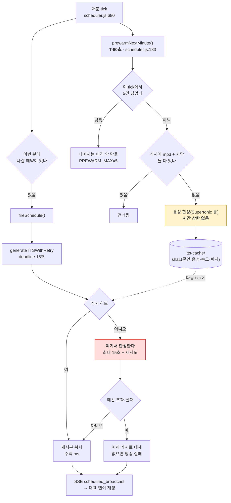
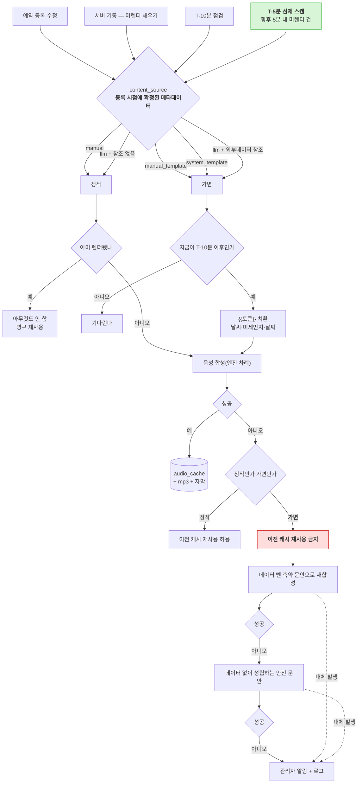
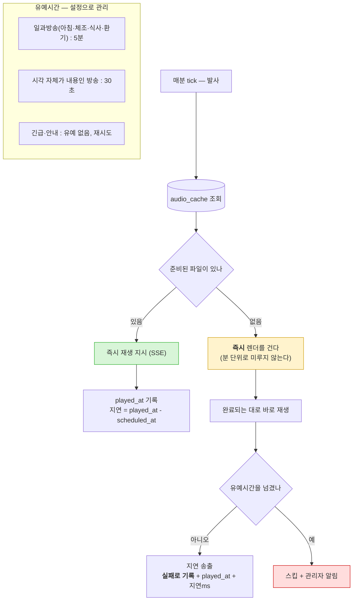
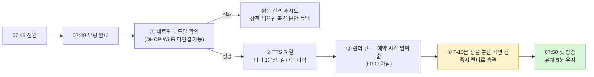

# 예약 방송 파이프라인 — 지금 흐름과 개선 흐름

> **공개판 안내:** 2026-09 시점 설계 기록입니다. 줄 번호는 지금 코드와 어긋나고, 공개판에 없는 내부 문서(CLAUDE.md·docs/journal 등)를 가리키는 곳이 있습니다.

> 목적: 12:00 예약이 12:01 전후에 나가는 문제를 구조로 없앤다.
> 작성 2026-09-06 · 결정 반영 2026-09-06 · **코드는 아직 안 고쳤다.**
> 아래 [FACT] 는 전부 소스를 읽어 확인한 것이고 파일:줄을 달았다.

---

## 1. 지금 흐름 (as-is)

### 지연이 생기는 자리 [FACT]

| # | 사실 | 근거 |
|---|---|---|
| A | 사전 합성은 **발사 1분 전**에 시작한다 | `scheduler.js:183,188` — `now + 60_000` 분의 예약을 찾는다 |
| B | 사전 합성에는 **시간 상한이 없다** | `scheduler.js:213` — `deadlineMs` 없이 부른다 |
| C | **발사 경로가 TTS를 다시 부른다** | `scheduler.js:435` |
| D | 그 예산이 **15초**다 | `tts.js:441` `BROADCAST_BUDGET_MS = 15000` |
| E | 한 tick에 **5건까지만** 미리 만든다 | `scheduler.js:165,198` `PREWARM_MAX = 5` |
| F | 캐시 키에 **볼륨은 없다** | `tts.js:308` |
| G | 준비 시간은 **이미 기록된다** | `scheduler.js:135` `broadcasts.prep_ms` |

**그래서 12:01이 된다**: A 로 60초를 준 뒤, 그 안에 못 끝나면 C 가 발사 시각에 **다시** 합성을
시작한다(D 로 최대 15초). 60초 + 15초가 곧 관측된 지연이다.

**덤 [INFER]**: 사전 합성이 도는 중에 발사 시각이 오면 캐시가 아직 없으므로 C 가 **같은 문안을
한 번 더** 합성한다.

### 볼륨 전수 조사 결과 (2026-09-06, 결정 완료)

| 확인 대상 | 결과 | 근거 |
|---|---|---|
| `generateTTS` 시그니처 | 볼륨 인자를 **안 받는다** | [FACT] EV-000517 `tts.js:100` |
| 합성 호출처 8곳 전부 | 가변 볼륨 전달 **0건** | [FACT] EV-000517 |
| SSML `<prosody>` | **상수** `volume='+2dB'` 하나 | [FACT] EV-000515 `tts.js:136` |

**결정: +2dB 는 제거하지 않는다.** 이것은 재생 볼륨이 아니라 **고정 합성 게인**이다.
요양원 안내방송에서 2dB 감소는 어르신 청취 실패로 직결되고, 현재 값은 현장 음량 기준으로
맞춰진 값이다. 바꾸려면 **현장 스피커 청취 확인(MT)** 을 거친다.
가변 볼륨이 합성에 섞인 적이 없으므로 **기존 캐시의 정합성은 유지된다** — 전면 무효화하지 않는다.

---

## 2. 개선 흐름 (to-be)

### 2-1. render — 방송 시각과 무관하게 돈다

**가변 문안이 이전 캐시를 절대 안 쓰는 이유**: 어제 날씨를 오늘 방송하는 것은 **틀린 정보를
확신을 갖고 말하는 것**이라, 방송이 빠지는 것보다 나쁘다. 무인 운영에서는 정정할 사람이 없다.

### 2-2. play — 트리거 시각. 네트워크·TTS 없음

**`play` 상자에서 밖으로 나가는 화살표가 없다** — DB 조회와 파일 재생뿐이다.
"없음" 가지는 **선제 스캔(T-5분)을 뚫고 온 예외**를 받는 자리이지 정상 경로가 아니다.

---

## 3. 판정 규칙 — 추측을 어디에도 두지 않는다

### 3-1. `content_source` (등록 시점에 확정)

| 값 | 뜻 | 렌더 시점 | 폴백 |
|---|---|---|---|
| `manual` | 사람이 작성, 토큰 없음 | 등록 즉시 1회 | 이전 캐시 재사용 가능 |
| `manual_template` | 사람이 작성, `{{토큰}}` 포함 | T-10분 재렌더 | **이전 캐시 금지** |
| `system_template` | 시스템 서식 + 외부 데이터 | T-10분 재렌더 | **이전 캐시 금지** |
| `llm` | LLM 생성 | 외부 데이터 참조 여부로 분기 | 참조하면 금지 |

`manual` 과 `manual_template` 의 구분은 **저장 시점에 정규식 한 번**으로 정해진다:
`/\{\{\s*([가-힣A-Za-z_][^}]*)\s*\}\}/` 가 하나라도 맞으면 `manual_template`.
**낱말 추정은 어디에도 없다.** 같은 문안은 언제 판정해도 같은 값이 나온다.

### 3-2. 토큰 사전 — 단일 출처

토큰 목록은 `server/domain/contentTokens.js` 한 곳에만 둔다(온톨로지·볼륨과 같은 규칙).
등록 화면·치환기·판정기가 **같은 사전**을 본다. 알 수 없는 토큰은 **저장 단계에서 거부**한다 —
방송 시각에 `{{날시}}` 가 그대로 읽히는 것을 막는다.

초기 토큰: `{{날씨}}` `{{기온}}` `{{미세먼지}}` `{{날짜}}` `{{요일}}` `{{시각}}`

### 3-3. "시각 자체가 내용인 방송"도 추측하지 않는다

Q3 의 유예 30초 대상은 **`{{시각}}` 토큰을 포함한 문안**으로 정의한다.
같은 토큰 사전을 재사용하므로 판정이 결정론적이고, 새 규칙이 늘지 않는다.

### 3-4. 가변 캐시의 수명

가변 문안(`*_template`, 외부데이터 `llm`)의 오디오는 **예약 시각이 지나면 폐기**한다.
실수로 재사용될 여지를 남기지 않는다. 정적 문안은 기존 30일 청소(`pruneCache`)를 따른다.

---

## 4. 캐시 키 (확정)

| 항목 | 포함 | 근거 |
|---|---|---|
| 문안(정규화 후) | **포함** | 합성 결과 바이트를 바꾼다 |
| voice | **포함** | 모델이 바뀌면 소리가 바뀐다 |
| rate | **포함** | SSML `<prosody rate>` 로 반영 |
| pitch | **포함** | SSML `<prosody pitch>` 로 반영 |
| **엔진 salt** | **포함(신설)** | 엔진마다(모델판·화자·출력 형식) — 2026-09-21 엔진 교체로 옛 판번호·게인 소금은 걷었다 |
| 볼륨 | **제외** | 재생 시점 값. 넣으면 같은 문장을 볼륨 가짓수만큼 재합성한다 |

**문안 정규화**: 앞뒤 공백 제거 · 연속 공백 1칸 · 전각→반각(영숫자·괄호·문장부호) · NFC 정규화.
표기 차이로 인한 캐시 미스를 없앤다.

**salt 초기값은 지금 캐시를 살린다.** salt 가 기준값일 때 다이제스트가 **옛 키와 글자 하나까지
같도록** 정의한다(기준값이면 salt 를 해시 입력에 넣지 않는다). 그래서 도입 자체로는 아무것도
무효화되지 않고, 엔진·템플릿·게인이 바뀌는 순간부터 자동 무효화가 걸린다.
이 성질은 테스트로 고정한다(§7 수용 기준 7).

---

## 5. 확인이 필요한 것 — 앞선 제약과 부딪히는 두 가지

### C1. `content_source` 는 `schedules` 에도 있어야 한다

지시는 "**broadcasts** 테이블에 `content_source` 추가"였다. 그런데 **렌더 시점을 정하는 판단은
방송이 나가기 전에** 이뤄지고, 그때 읽는 표는 `schedules` 다. `broadcasts` 는 나간 뒤에 쓰는
이력이라 렌더 결정에 쓸 수 없다.

→ **두 곳 모두**에 두기를 제안한다. `schedules.content_source` 가 **판정의 권위**이고,
`broadcasts.content_source` 는 **그때 무엇으로 나갔는지의 기록**이다(사후 조회·감사용).

### C2. 토큰 목록을 화면에 보이려면 UI 가 바뀐다

처음 제약은 "UI/UX 는 변경하지 않는다"였는데, Q2.2 는 "사용 가능한 토큰 목록을 작성 화면에
제시한다"이다. 서로 부딪힌다.

→ Q2.2 가 나중 지시이므로 **그것을 따르되, 최소 추가로 한정**한다: 예약 작성 폼의 내용 입력
아래에 **토큰 칩 한 줄**(누르면 커서 위치에 삽입). 기존 흐름·배치·문구는 그대로 둔다.
그 외 UI 는 손대지 않는다.

---

## 6. 영향 범위

| 항목 | 영향 |
|---|---|
| **DB 스키마** | **있음** — `audio_cache` 신설, `schedules.content_source`, `broadcasts` 에 `content_source`·`scheduled_at`·`rendered_at`·`played_at`·`delay_ms`. 마이그레이션 + `schema.expected.json` + `verify:db` 세 개가 한 세트 |
| **API 계약** | 추가만 — 지연 조회 엔드포인트 1개 신설 |
| **Frontend** | **토큰 칩 한 줄만**(C2). SSE 이벤트 모양은 그대로 |
| **Scheduler·방송 실행** | **큼** — `fireScheduleInner` 의 TTS 호출 제거, `prewarmNextMinute` → 렌더 큐로 대체, T-5분 스캔·T-10분 재렌더 잡 신설 |
| **기존 데이터 호환** | 기존 예약은 `content_source` 가 없다 → 마이그레이션에서 **토큰 정규식으로 1회 판정**해 채운다(그 뒤로는 저장 시점에만 정한다). 렌더 이력도 없으므로 기동 시 채우기 경로가 받는다 |

**범위 한정**: 이번은 **예약(`schedules`)만** 바꾼다. 자동방송 5종(`broadcastSequencer`)과
흐름(`flowRunner`)도 TTS를 부르지만 문안을 시스템이 짓기 때문에 규칙이 다르다 — 다음 단계로 둔다.

---

## 7. 수용 기준 (각각이 테스트 1개가 된다)

1. 트리거 경로(`fireScheduleInner`)에 `generateTTS*` 호출이 **0건**이다(소스 대조).
2. 준비된 예약의 `played_at - scheduled_at` 이 **1초 미만**이다(가짜 시계).
3. 같은 문안·음성·속도의 예약을 둘 만들면 합성은 **1회**만 일어난다(호출 계수).
4. `{{토큰}}` 이 있는 문안은 `manual_template` 으로 저장되고, 렌더 실패 시 **이전 캐시를 쓰지 않는다.**
5. 알 수 없는 토큰은 **저장이 거부**된다.
6. 유예를 넘긴 건은 스킵되고 경보가 **1건** 남는다. 넘지 않은 지연 송출은 **실패로 기록되며 `delay_ms` 가 남는다.**
7. **salt 가 기준값이면 캐시 키가 옛 키와 같다**(전면 무효화가 안 일어난다). salt 를 바꾸면 달라진다.
8. 문안 정규화: 표기만 다른 두 문장(앞뒤 공백·연속 공백·전각)이 **같은 키**를 만든다.
9. UI 는 토큰 칩 외에 바뀌지 않는다 — SSE `scheduled_broadcast` 필드 구성이 그대로다(소스 대조).

---

## 8. 다음 단계

C1·C2 확인을 받고 구현 계획(§단계 나누기)을 승인받은 뒤 코드를 고친다(CLAUDE.md 게이트 1).
`dev` 에서만 작업하고 `main` 은 건드리지 않는다.

---

## 9. 현장 제약 반영 (2026-09-06 결정)

### 9-1. 부팅과 첫 방송 사이 — 매일 반복되는 구조적 문제

현장 PC 는 **07:45 전원 · 07:49 부팅 완료 · 07:50 첫 일과방송**이다.
가변 문안의 렌더 창(T-10분 = **07:40**)에 PC 가 꺼져 있어 **한 번도 렌더되지 않은 채**
트리거를 맞는다. 정적 문안은 전날 캐시가 남아 무관하다.

- **7항** 기동 시 렌더 큐는 **예약 시각 임박 순**으로 정렬한다. 등록 순서·FIFO 가 아니다.
- **8항** 가변 문안의 렌더 시점을 다시 쓴다 —
  ~~"T-10분에만"~~ → **"T-10분, 또는 그 시점 이후 최초로 가능한 순간"**.
  부팅 지연·재시작으로 창을 놓친 건은 **즉시 렌더로 승격**한다.
- **9항** 기동 직후 외부 API 를 바로 부르지 않는다. 도달 확인 → 짧은 간격 재시도 →
  상한 초과 시 축약 문안 폴백.
- **10항** 기동 시 **TTS 예열** 1회(더미 문장, 결과 폐기). 엔진 준비(모델 적재) 비용을
  첫 실제 방송 이전에 치른다.
- **11항** 아침 첫 방송 유예는 **5분 유지**. 30초로 줄이지 않는다.
- **13항** 기동→첫 방송 구간을 **측정 가능하게** 로그로 남긴다:
  서버 기동 시각 · 네트워크 준비 완료 시각 · 첫 렌더 완료 시각 · 첫 `played_at`.

### 9-2. 12항 조사 결과 — 서버는 브라우저와 무관하게 뜬다

[FACT] EV-000520 — `scripts/carecast-loop.template.bat:39` 이 `start /b node server\index.js` 로
서버를 **먼저** 띄우고, 브라우저(Edge)는 `:50` 에서 **그 뒤에 별개로** 뜬다.
감시 루프는 서버가 죽으면 되살린다([FACT] EV-000518 `startBatCheck.js` 머리말).

→ **렌더는 브라우저에 의존하지 않는다. Windows 서비스로 분리할 필요가 없다.**
다만 **재생은 브라우저에 의존한다**(대표 탭, §PROJECT_PROFILE 1-3·1-4). 렌더는 브라우저 없이도
쌓이고, 재생만 창이 열려야 한다 — 이 비대칭이 이번 설계의 이점이다.

### 9-3. 유예 판정 우선순위 (1항)

**위에서 아래로 평가하고 첫 일치에서 확정한다.**

| 순위 | 조건 | 유예 |
|---|---|---|
| 1 | 긴급·안내 (`schedules.urgency = 'emergency'`) | **없음** — 성공까지 재시도 |
| 2 | 문안에 `{{시각}}` 토큰 포함 | **30초** |
| 3 | 그 외 | **5분** |

[FACT] EV-000519 — **지금 긴급방송은 예약을 지나지 않는다**(`routes/tts.js:27` 의 즉시 방송
경로, `priority=true`). 그래서 1순위는 현재 예약에 걸리지 않는다. 그럼에도 `urgency` 컬럼을
**이번 마이그레이션에 미리 넣는다** — 나중에 컬럼을 더하려고 마이그레이션을 또 만들지 않기 위해서다.

### 9-4. 14항 확인 — 가변은 등록 시점에 렌더하지 않는다

맞다. 등록 시점에 만든 날씨 음성은 **쓸 수 없고 옛 파일이 캐시에 있는 상태만 만든다.**
가변의 렌더 시점은 **T-10분(및 8항 승격 경로) 하나**다. 문서 §2-1 의 다이어그램이 이미
`vwhen{"지금이 T-10분 이후인가"} -->|아니오| vwait["기다린다"]` 로 그렇게 그려져 있다.

### 9-5. 두 `content_source` 의 역할 분담 (C1)

| 위치 | 역할 | 언제 읽나 |
|---|---|---|
| `schedules.content_source` | **판정의 권위.** 렌더 시점 결정은 **여기만** 읽는다 | 방송 **전** |
| `broadcasts.content_source` | 그때 실제로 무엇으로 나갔는지의 **스냅샷** | 방송 **후**(조회·감사) |

**두 값은 다를 수 있다** — 등록 뒤 문안이 수정되면 `schedules` 는 새 값, 지난 `broadcasts`
행은 그때의 값이다. 스키마 주석에도 같은 문장을 남긴다.

### 9-6. 3단계 착수 조건 (4·5항) — 판단이 아니라 측정

아래 **셋을 전부** 만족할 때만 3단계에 착수한다. 하나라도 미달이면 2단계를 더 관찰한다.

- [ ] dev 에서 실제 예약 방송이 **연속 3일 이상** 정상 송출됐다
- [ ] 그 기간 **미렌더 상태로 트리거를 만난 건수가 0** 이다
- [ ] **T-5분 선제 스캔이 매 실행 로그에 남아 있다**

3단계는 dev 에 **최소 3일** 머문다. 그 사이 **main 병합을 하지 않는다** —
자동 업데이트를 켠 현장 PC 는 main 을 10분마다 받으므로, 되돌리기 어려운 변경에는 관찰 기간을 둔다.

### 9-7. 기록 (6항)

단계마다 판단이 뒤집히거나 예상과 다른 결과가 나오면 `docs/journal/decisions.md` 에 남긴다.
**3단계 실측은 숫자가 나오는 지점이므로 개선 전/후를 반드시 남긴다.**

### 9-8. 기존 문안 스캔 (2항)

마이그레이션은 기존 문안에 `{{` 가 든 건이 있는지 **스캔만 하고 리포트로 보고**한다.
**자동 수정하지 않는다.** 알 수 없는 토큰의 저장 거부는 **새 저장에만** 적용하고
기존 레코드는 검증 대상에서 제외한다.
