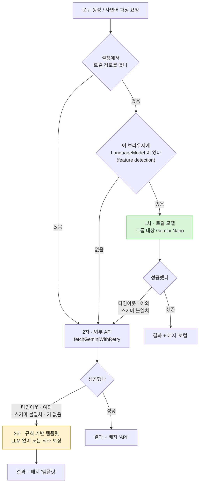
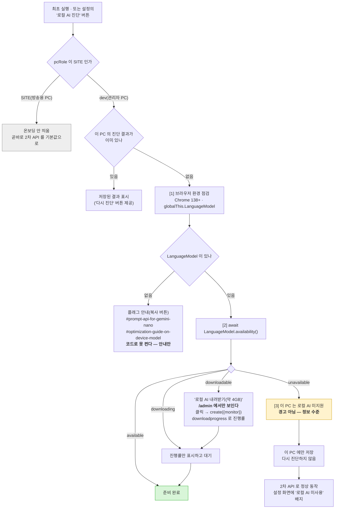

# LLM 3단 폴백 + 로컬 모델 온보딩 — 설계

> **공개판 안내:** 2026-09 시점 설계 기록입니다. 공개판에 없는 내부 문서(CLAUDE.md 등)를 가리키는 곳이 있습니다.

> **이 문서는 설계만이다. 코드는 아직 한 줄도 안 고쳤다.**
> 2-a 관찰이 진행 중이라 구현은 관찰 종료 후 별도 지시로 시작한다.
> 구현은 `dev` 가 아니라 **`feature/llm-fallback`** 에서 하고, 관찰 통과 후 `dev` 로 병합한다.
>
> 작성 2026-09-06 · 아래 [FACT] 는 소스를 읽어 확인한 것이고 파일:줄을 달았다.

---

## 1. 지금 LLM 을 부르는 곳 — 전수 조사

[FACT] EV-000667·EV-000668·EV-000669 — `fetchGeminiWithRetry` 를 부르는 곳은 **네 곳**이다.
(직접 `fetch` 로 Gemini 를 부르는 곳은 없다. CLAUDE.md 규칙대로 전부 이 창구를 지난다.)

| # | 위치 | 무엇을 하나 | 3단 폴백에서 |
|---|---|---|---|
| 1 | `routes/ai.js:30` (`POST /api/ai/generate`) | **방송 문구 생성** — 상황을 주면 안내문을 써 준다 | **대상** — 1차 로컬 → 2차 API → 3차 템플릿 |
| 2 | `routes/scheduleDrafts.js:311` (`parseWithGemini`) | **자연어 → 예약 초안 파싱** — "내일 2시 프로그램 안내" → 날짜·시각·유형 | **대상** — 1차 로컬 → 2차 API → 3차 규칙 파서 |
| 3 | `routes/audio.js:340` (`POST /files/:id/subtitle/polish`) | **자막 다듬기** — 받아쓰기가 잘못 들은 낱말을 고친다(줄 수는 유지) | **대상 아님(이번 범위 밖)** — 아래 이유 |
| 4 | `routes/ai.js:126` (`handleGeminiTest`) | **API 키 연결 시험** — 관리자 화면의 "연결 테스트" 버튼 | **대상 아님** — 외부 API 가 살아 있는지 보는 것이 목적이다 |

**3번을 빼는 이유**: 자막 다듬기는 **줄 수를 바꾸지 않는다**는 제약이 핵심인데
(`audio.js:321` 규칙 3), 작은 로컬 모델이 그 제약을 지킬지 확인된 바 없다. 지키지 못하면
자막이 소리와 어긋나 홀 화면에 잘못 뜬다. 그리고 이 기능은 **사람이 확인하고 올리는
초안**이라(검토 게이트) 실패해도 방송이 안 멈춘다 — 급하지 않다.
로컬 모델이 실제로 도는 것을 보고 나서 옮긴다.

**4번을 빼는 이유**: 그 버튼의 목적이 "외부 API 가 되는가"이다. 폴백을 끼우면
API 가 죽었는데 "정상"으로 보인다.

---

## 2. 3단 폴백 흐름



### 전환 조건 — 명시적으로 정한다

| 조건 | 값 | 왜 |
|---|---|---|
| 타임아웃 | 로컬 **8초** · API **기존 값 유지**(`geminiClient.GEMINI_TIMEOUT_MS`) | 로컬은 네트워크가 없어 빨라야 정상이다. 8초를 넘으면 그 PC 에서는 못 쓰는 것이다 |
| 예외 | 어떤 예외든 다음 단계로 | 원인을 가리지 않는다. 사람이 기다리는 자리다 |
| 스키마 불일치 | 파싱 실패·필수 필드 없음 | 특히 자연어 파싱은 JSON 모양이 어긋나면 그대로 못 쓴다 |
| 빈 응답 | 공백만 있는 결과 | 성공으로 위장된 실패다 |

**전환은 조용하다.** 1차가 안 되면 사용자에게 묻지 않고 2차로 간다.
방송 경로에서 사람을 막지 않는다(제약 6·9).

### 어떤 단계가 쓰였는지 남긴다

- **로그**: `[LLM] 문구생성 — 로컬(1.2초)` / `[LLM] 자연어파싱 — API(3.4초, 로컬 실패: 타임아웃)`
- **UI 배지**: 결과 카드에 `로컬` / `API` / `템플릿` 을 붙인다.
  **템플릿 배지는 눈에 띄어야 한다** — LLM 없이 나온 결과임을 사람이 알아야 한다.

---

## 3. 온보딩(로컬 AI 진단) 흐름



### 사전 요건 — 진단 결과에 함께 보여 준다

- Chrome 프로필이 있는 볼륨에 **22GB 이상** 여유
- **GPU VRAM 4GB 초과**, 또는 **RAM 16GB 이상 + 4코어 이상**
- 종량제가 아닌 네트워크
- 문제가 계속되면 `chrome://on-device-internals` 확인 안내

### 다중 PC 대응 (B-2)

**크롬 Prompt API 는 서버가 아니라 브라우저에서 돈다.** 그래서 진단 결과는
**서버 전역이 아니라 그 브라우저에만** 저장한다(`localStorage`). 방송용 PC 와 관리자 PC 는
사양이 다르므로 한쪽 결과를 다른 쪽에 적용하면 틀린다.

**송출 전용 여부는 `pcRole` 로 판단한다. 새 설정을 만들지 않는다.**
이미 `autoShutdown`·`audioDeviceWatcher` 가 그 판단을 쓰고 있고, 같은 판단이 두 군데로
갈라지면 이번에 겪은 방송 시각 불일치와 같은 사고가 난다.
`pcRole.js` 머리말의 "역할에 새 동작을 걸 때는 여기 한 줄 적고 테스트로 고정한다"를 따른다 —
**이 작업에서 그 목록에 세 번째 줄이 늘어난다.**

---

## 4. 3차 템플릿이 실제로 내놓는 것

LLM 이 하나도 안 될 때에도 **기능이 멈추지 않아야 한다.** 다만 "그럴듯한 가짜"를 만들지 않는다 —
템플릿이 만든 것임을 배지로 밝히고, 사람이 고칠 수 있는 초안으로 낸다.

### 4-1. 문구 생성 (`/api/ai/generate`)

입력에서 **상황 낱말**만 뽑아 정해진 틀에 끼운다. 새 문장을 지어내지 않는다.

| 입력 | 템플릿 결과 |
|---|---|
| "점심 배식 안내" | `어르신 여러분, 안내 말씀드립니다. 점심 배식을 시작하겠습니다. 감사합니다.` |
| "3층 물 잠금" | `어르신 여러분, 안내 말씀드립니다. 3층 물 잠금 관련 안내입니다. 자세한 내용은 직원에게 문의해 주시기 바랍니다. 감사합니다.` |
| (알 수 없음) | `어르신 여러분, 안내 말씀드립니다. (내용을 입력해 주세요) 감사합니다.` |

틀은 현장 문안에서 가져온다 — 시작 인사와 끝인사가 `favorites` 의 빠른 방송 문구와 같은
모양이다(현장 사본 확인: "어르신 여러분, … 바랍니다."). **낯선 말투가 튀지 않게** 한다.

### 4-2. 자연어 파싱 (`parseWithGemini`)

**이미 규칙 기반 파서가 있다** — `server/services/schedulePhrase.js` 다
(`QuickSchedulePhrase.jsx` 가 쓰는 `/api/schedules/parse-phrase`).
3차는 **새로 만들지 않고 그것을 부른다.** 같은 일을 두 번 구현하지 않는다.

| 입력 | 템플릿(규칙) 결과 |
|---|---|
| "매일 오후 3시에 산책 안내" | `{ scheduled_time: "15:00", repeat: 매일, broadcast_type: "text", content: "산책 안내" }` |
| "저녁 6시에 차임벨 울려줘" | `{ scheduled_time: "18:00", broadcast_type: "chime" }` |
| "다음주 화요일 뭐시기" | 시각을 못 읽으면 **`ambiguous` 에 담아 사람에게 되묻는다** — 조용히 정하지 않는다 |

규칙 파서가 못 읽은 항목은 **확인 카드로 되묻는** 기존 규약을 그대로 쓴다(CLAUDE.md 검토 게이트).

---

## 5. 어댑터 인터페이스 — 하나, 구현체 셋

**팩토리·레지스트리·플러그인 구조를 만들지 않는다**(CLAUDE.md 구조 단순성 원칙 5).
지금 필요한 것은 인터페이스 하나와 구현체 셋이다.

```
generate({ kind, input, timeoutMs }) → { ok, data, via }
   kind : 'text' | 'schedule'      무엇을 시키는지
   via  : 'local' | 'api' | 'template'
```

**1차 로컬 구현체는 향후 교체 가능하다.** 지금은 크롬 내장 Gemini Nano 하나뿐이지만,
다른 로컬 런타임이 생기면 **같은 인터페이스를 만족하는 파일 하나를 더하고 순서 배열에
끼우기만** 하면 된다. 지금 그 확장 지점을 코드로 만들지는 않는다 —
**두 번째 사례가 실제로 생겼을 때** 만든다.

---

## 6. 새로 만들 파일 · 고칠 파일

**새로 만든다 (5개)**

| 파일 | 한 문장 |
|---|---|
| `server/domain/llmTemplate.js` | LLM 없이 문구를 만드는 규칙 템플릿 |
| `server/services/llmGateway.js` | 3단을 순서대로 시도하고 어느 단계가 쓰였는지 돌려준다 |
| `src/lib/localModel.js` | 브라우저의 `LanguageModel` 감지·호출(1차 구현체) |
| `src/components/admin/sections/LocalAiSetup.jsx` | 로컬 AI 진단·다운로드 화면 |
| `server/test/llm-fallback.test.js` | 전환 조건과 "무엇이 없어도 결과가 나온다"를 고정 |

**고친다 (4개)**

| 파일 | 무엇 |
|---|---|
| `server/routes/ai.js` | `/generate` 가 `llmGateway` 를 지나게. `/test` 는 **그대로 둔다** |
| `server/routes/scheduleDrafts.js` | `parseWithGemini` 를 게이트웨이 뒤로. 3차는 기존 규칙 파서 재사용 |
| `server/services/pcRole.js` | 머리말의 "역할에 걸린 동작" 목록에 한 줄 추가 |
| `src/pages/AdminMode.jsx` | 진단 화면 진입점(설정 화면 버튼) |

**안 만든다**: Electron 패키징 · 네이티브 모듈(`node-llama-cpp` 등) · 모델 파일을
서버에 두는 구조. 배포 전제는 **현장 PC 에서 크롬으로 localhost 접속** 그대로다.

---

## 7. 제약 확인

| # | 제약 | 어떻게 지키나 |
|---|---|---|
| 9 | 온보딩 미완료여도 방송 100% 정상 | 방송 경로는 LLM 을 안 쓴다. 문구 생성·파싱은 **사람이 누를 때만** 돈다 |
| 10 | 온보딩이 스케줄러를 블로킹 금지 | 온보딩은 **브라우저**에서 돈다. 서버 기동 경로에 안 들어간다 |
| 11 | 과한 추상화 금지 | 인터페이스 1 + 구현체 3. 등록 지점은 **배열 하나** |

---

## 8. 다음 단계

이 문서를 확인받은 뒤 `feature/llm-fallback` 브랜치에서 구현을 시작한다.
**2-a 관찰이 끝나고 통과한 뒤에 `dev` 로 병합한다.**

---

## 9. 구현 결과 — 설계에서 달라진 것 (2026-09-06)

구현은 `feature/llm-fallback` 에서 끝냈다. 두 가지가 설계와 다르고, 둘 다 **일부러** 그렇게 했다.

### 9-1. 자연어 파싱(#2)에는 1차 로컬을 넣지 않았다

설계 §1 표는 #2 를 "1차 로컬 → 2차 API → 3차 규칙 파서"로 잡았다. **구현은 2단이다** —
2차 API → 3차 규칙 파서(`services/schedulePhrase.js` 재사용).

**왜**: 3차가 이미 규칙 파서다. 규칙 파서는 "매일 오후 3시" 같은 한국어 시각 표현을
즉시·정확히 읽는다([FACT] EV-000693 — `server/test/llm-parse-fallback.test.js` 가
`15:00`·`18:00`+`chime` 을 고정한다). 그 앞에 작은 로컬 모델을 세우면 **더 느리고 덜 정확한
단계가 하나 늘어난다.** 로컬이 JSON 스키마를 안정적으로 낼지도 아직 재 본 적이 없다.

**언제 다시 볼까**: 로컬 모델이 실제로 도는 PC 에서 JSON 출력 안정성을 재고 나서.
등록해 뒀다 — `docs/audit/TODO.md` T-15.

### 9-2. 진입점은 `AdminMode.jsx` 가 아니라 AI 설정 카드 안이다

설계 §6 은 `src/pages/AdminMode.jsx` 를 고친다고 적었다. 실제로는
`src/components/admin/sections/APISettings.jsx` 의 "AI 방송 도우미" 묶음에 카드를 하나 더했다.
`AdminMode.jsx` 는 **한 줄도 안 고쳤다.**

**왜**: 사이드바 항목을 새로 만들면 화면 층이 하나 는다. 사람이 로컬 AI 를 찾을 자리는
이미 "AI · API 연동"이다(CLAUDE.md 구조 단순성 원칙).

### 9-3. 1차를 켜는 스위치는 새 설정이 아니라 **이 브라우저의 진단 결과**다

설계 흐름도의 "설정에서 로컬 경로를 켰나"는 새 설정 키로 읽힐 수 있어 밝혀 둔다.
판단 근거는 `localStorage['carecast:localAi:diagnosis'].status === 'available'` 하나다
(`src/lib/localModel.js` `localFirstEnabled`).

서버 설정으로 두면 **관리자 PC 에서 켠 것이 방송용 PC 에도 켜진다** — 사양이 달라 틀린다.
진단을 한 번도 안 한 브라우저는 1차를 건너뛰고 곧바로 서버로 간다(매 호출마다
`availability()` 를 부르면 그만큼 사람이 기다린다).

### 9-4. 만든 것 · 고친 것

| 파일 | 무엇 |
|---|---|
| `src/lib/localModel.js` (신규) | 감지·호출·진단 저장. 전역을 인자로 받아 브라우저 없이도 읽을 수 있다 |
| `src/components/admin/sections/LocalAiSetup.jsx` (신규) | 진단·내려받기 화면. **현장 PC 에는 안 뜬다** |
| `src/components/admin/sections/APISettings.jsx` | 카드 한 줄 추가 |
| `src/components/easy/TTSBroadcast.jsx` | 1차 로컬 시도 + 어느 단계가 썼는지 배지 |
| `server/services/pcRole.js` | 머리말 "역할에 걸린 동작" 3번 추가 |
| `server/test/pc-role.test.js` | 위 규칙 3개를 소스 대조로 고정 |

**남은 것은 MT 다.** 이 PC 에 로컬 모델이 있는지 없는지는 코드로 알 수 없다 —
관리자 화면에서 "진단하기"를 눌러 봐야 한다.

---

## 10. 이 개발 PC 실측 (2026-09-06)

> **⚠ 아래 §10-1 의 결론은 틀렸다. §10-2 가 정정본이다.**
> 틀린 채로 지우지 않고 남긴다 — 어떻게 틀렸는지가 다음 사람에게 필요한 정보다.

### 10-1. 첫 측정과 그 잘못된 결론 (철회)

크롬 MCP 로 브라우저에서 직접 재 봤다(중립 origin `https://example.com` — CareCast 화면을
열면 예약이 발동해 소리가 날 수 있어 피했다).

| 항목 | 값 |
|---|---|
| 크롬 | 152 |
| `globalThis.LanguageModel` | **있음**(function). `Summarizer` 도 있음, `Writer` 없음 |
| `LanguageModel.availability()` | **`unavailable`** |
| `LanguageModel.create()` 거부 사유 | `NotSupportedError: Unable to create a text session because the service is not running.` |
| GPU | NVIDIA RTX 2060 (VRAM 6GB — 요건 4GB 초과 **만족**) |
| RAM · 코어 | 16GB · 16코어 (**만족**) |

여기서 **"사전 요건을 다 만족해도 unavailable 이 나온다"** 고 결론지었다. **틀렸다.**

### 10-2. 정정 — 측정 대상이 평범한 크롬이 아니었다 (2026-09-06)

`chrome://version` 을 읽고 알았다. §10-1 이 잰 크롬은 **사용자가 평소 쓰는 크롬이 아니다.**

- 프로필: `C:\Users\...\.cache\chrome-devtools-mcp\chrome-profile\Default` (MCP 전용 임시 프로필)
- 실행 인자에 **`--disable-features=Translate,AcceptCHFrame,MediaRouter,OptimizationHints,…`**

**온디바이스 모델은 Optimization Guide 로 배달된다.** 그것을 끈 채로 쟀으니 `unavailable` 이
나오는 게 당연했다. `chrome://components` 에 *Optimization Guide On Device Model* 이 아예
목록에 없던 것도 같은 이유다.

**평범한 크롬으로 다시 쟀다.** 별도 프로필·별도 디버깅 포트로 크롬을 띄우고, 보안 컨텍스트
(`http://127.0.0.1` — 로컬 호스트는 보안 컨텍스트다)에서 측정했다:

| 실행 인자 | `LanguageModel` | `availability()` |
|---|---|---|
| **아무것도 안 붙임** | function | **`downloadable`** |
| `--enable-features=OptimizationGuideOnDeviceModel` | function | `downloadable` |
| `…:performance_class_override/high` | function | `downloadable` |

**결론이 뒤집혔다. 이 PC 는 로컬 AI 를 쓸 수 있다.** 플래그도 필요 없다(크롬 152 는 Prompt API 가
정식 기능이다). 남은 것은 약 4GB 내려받기뿐이고, 디스크도 넉넉하다(C: 여유 50.7GB).

### 10-3. 그래서 앞으로 조심할 것 — 재는 조건 셋

이번에 같은 하루에 **세 번** 조건 때문에 틀린 값을 봤다. 순서대로 적는다.

| 무엇을 틀렸나 | 나온 값 | 진짜 이유 |
|---|---|---|
| MCP 크롬으로 쟀다 | `unavailable` | `--disable-features=…OptimizationHints` |
| `about:blank` 에서 쟀다 | `LanguageModel` 자체가 **undefined** | 보안 컨텍스트가 아니다 |
| 이동이 끝나기 전에 쟀다 | `location.href` 가 `about:blank` | 타깃 목록의 URL 은 갱신됐지만 프레임은 아직 |

**그러므로 이 기능은 chrome-devtools MCP 로 검증할 수 없다.** MCP 크롬은 구조적으로 항상
`unavailable` 을 낸다. 화면 확인은 **사람이 자기 크롬에서** 해야 한다 — MT 항목이다.

### 10-4. (참고) 진짜로 `unavailable` 인 PC 를 위한 안내는 그대로 둔다

그래서 화면을 고쳤다 — 처음 판에는 플래그 안내를 `unsupported`(API 자체가 없음)일 때만
띄웠는데, **정작 필요한 자리는 `unavailable`** 이었다. 지금은 `unavailable` 에서도
① 플래그 두 개 ② `chrome://components` 의 *Optimization Guide On Device Model* 내려받기
③ `chrome://on-device-internals` 를 순서대로 안내하고, 크롬이 준 거부 문장을 **그대로** 보여 준다.
PC 사양 요건은 접어 두었다 — 흔한 원인이 아닌 것을 먼저 보여 주면 사람이 자기 기계를
의심하며 시간을 버린다.

## 11. 허용 스위치 — "허용"과 "가능"은 다른 것이다 (2026-09-06 사용자 지시)

사용자 지시로 **설정 토글**을 넣었다. 다만 §9-3 의 이유(관리자 PC 에서 켠 것이 방송용 PC 에도
켜진다)가 여전히 유효해서, **둘을 합치지 않고 나란히 뒀다. 둘 다 참이어야 1차가 돈다.**

| | 무엇 | 어디 사나 | 없으면 |
|---|---|---|---|
| 허용 | 사람이 명시적으로 켠 것 | 서버 설정 `local_ai_enabled` (기본 **꺼짐**) | 승인한 적 없는데 모델이 돈다 |
| 가능 | 이 브라우저에 모델이 있나 | `localStorage` 진단 | 사양 다른 PC 에서 매번 1차가 실패하고 그만큼 사람이 기다린다 |

토글은 **`available` 로 진단된 뒤에만 눌린다.** 못 쓰는 PC 에서 켜 두면 "켰는데 왜 안 되냐"가 된다.
진단은 화면에 들어오면 한 번 저절로 돈다(읽기만 하는 조회라 내려받기 같은 부작용이 없다) —
사람이 버튼을 눌러야만 알 수 있으면 대부분 안 누른다.

## 12. "어느 단계가 썼는지" 어떻게 확인하나

| 기능 | 화면 | 로그 |
|---|---|---|
| 문구 생성 | 결과 위 한 줄 — *이 PC 안의 AI* / *외부 AI* / **AI 없이 정해진 틀** | 브라우저 콘솔 `[LLM] 문구생성 — …` |
| 자연어 → 예약 초안 | 초안 카드 위 한 줄 — 같은 세 가지 | 브라우저 콘솔 `[LLM] 자연어파싱 — …` · 서버 콘솔 `[예약파싱] …` |
| **예약 방송 실행** | — | **LLM 을 안 쓴다.** DB 에 저장된 값으로 돈다 |
| **자막 다듬기** | — | **이번 범위 밖**(§1 의 3번). 제미나이 전용이고 폴백도 배지도 없다 |

**템플릿·규칙으로 나온 것만 눈에 띄게 칠한다**(주황 굵게). 로컬·API 는 회색 한 줄이다 —
매번 눈에 띄면 사람이 곧 안 읽는다. 정작 확인이 필요한 것은 *LLM 없이 나온 결과*다.

---

## 13. 자막 다듬기도 대상에 넣었다 (2026-09-06 사용자 승인)

§1 표는 자막 다듬기(#3)를 "이번 범위 밖"으로 뒀다. **바꿨다** — 다만 넣은 방식이
설계 §1 이 예상한 것과 다르다.

### 1차 로컬은 여전히 안 넣는다. 넣은 것은 **3차**다

§1 이 뺀 이유("작은 로컬 모델이 줄 수 제약을 지킬지 확인된 바 없다")는 **그대로 유효하다.**
로컬 모델은 이 PC 에서 아직 돌지도 않는다(§10). 넣은 것은 **API 가 죽었을 때의 3차**다.

### 3차는 "원문 그대로"다 — 없는 규칙을 지어내지 않는다

받아쓴 글자를 고칠 규칙이 우리에게 없다. 정본이 있는 음원은 애초에 정본을 쓰면 되고
(`routes/audio.js` 의 `default-text`), **정본이 없는 것이 이 기능의 대상**이다.
그래서 3차는 아무것도 안 고치고, **안 고쳤다고 밝힌다.**

이 폴백의 값어치는 "더 잘 고치는 것"이 아니라 **"버튼이 막다른 길이 되지 않는 것"** 이다.
예전에는 키가 없으면 400, API 가 죽으면 502 로 끝나서 사람이 편집기에서 할 수 있는 일이 없었다.

### 여기서 제일 위험했던 것 — 두 가지가 **같은 말**이 될 뻔했다

화면은 예전에 `changed === 0` 이면 `"고칠 곳이 없었습니다"` 라고 적었다. 3차를 그대로 끼우면
**AI 가 죽은 경우와 정말 깨끗한 원고가 똑같은 문장**이 된다 — 사람은 다듬어진 줄 알고 넘어간다.
그래서 응답에 `via` 를 싣고 화면이 갈라 적는다:

> AI 를 쓰지 못해 원문을 그대로 뒀습니다 (API 경로 없음). 글자는 직접 고쳐 주세요 — 타이밍은 그대로입니다.

### 줄 수 검사는 옮겨 갔다 — 가드도 따라 옮겼다

`고침.length !== 원본.length` 는 라우트에서 `services/llmGateway.js` 의 `다듬기쓸만한가` 로
내려갔다. `caption-wiring.test.js` 의 가드도 같은 커밋에서 옮겼고, **소스 대조에 더해 실제
동작으로도** 잰다(줄을 합쳐 오는 가짜 API 를 넣어 원문이 유지되는지 확인).
일부러 깨뜨려 둘 다 빨간불인 것을 보고 되돌렸다([FACT] EV-000735).

**바뀐 규약**: 줄 수가 어긋나면 예전에는 **502** 였다. 이제는 **그 결과를 버리고 원문**이다.
사람이 보는 결과는 같다(어긋난 자막이 안 들어간다). 다른 것은 편집기가 안 죽는다는 점이다.

---

## 14. 1차를 브라우저에 둔 대가 — 서버 가드를 안 지난다 (2026-09-06)

로컬 모델을 내려받고 토글을 켠 직후에 발견했다. **설계에 없던 구멍이다.**

`routes/ai.js` 의 `/generate` 는 맨 앞에서 대시보드의 "AI 방송 도우미" 스위치를 본다
(`features.blockIfDisabled(res, 'ai', …)` → 꺼져 있으면 403). 그런데 **1차 로컬은 브라우저에서
돌아 서버를 아예 안 부른다.** 그래서 사람이 그 스위치를 꺼도 문구는 계속 만들어진다.

**이 실패가 나쁜 이유는 결과가 아니라 믿음에 있다.** 끈 사람은 껐다고 믿는다.
"안 꺼진다"보다 "껐는데 조용히 돈다"가 훨씬 찾기 어렵다.

### 어떻게 막았나 — 브라우저가 볼 값을 서버가 하나로 합쳐서 준다

`GET /api/settings/local-ai` 가 **둘의 곱**을 돌려준다:

```
enabled      = local_ai_enabled === '1'  &&  isFeatureEnabled('ai')
localAllowed = local_ai_enabled === '1'          ← 사람이 켠 기록 (체크 표시는 이걸 비춘다)
aiFeature    = isFeatureEnabled('ai')            ← 왜 안 도는지 구분
```

브라우저는 `enabled` 하나만 보면 된다. 판단을 화면에 나눠 두지 않는다 — 나누면 곧 갈린다.

**`localAllowed` 를 따로 둔 이유**: `enabled` 만 보내면 기능을 껐을 때 체크가 풀려 보인다.
그러면 사람은 자기가 끈 줄 알고, 기능을 다시 켠 뒤 **승인 절차를 처음부터 다시 밟는다.**
사람이 켠 기록은 기능 스위치와 무관하게 남아 있어야 한다.

`server/test/local-ai-toggle.test.js` 가 **동작으로** 잠근다(소스 대조가 아니다).
일부러 `&& isFeatureEnabled('ai')` 를 빼서 동작 테스트와 소스 가드가 **둘 다** 붉게 켜지는 것을
보고 되돌렸다([FACT] EV-000747).

### 남은 같은 종류의 구멍 — 아직 없다

1차 로컬을 태우는 곳은 지금 **문구 생성 한 곳뿐**이다(§9-1: 자연어 파싱에는 안 넣었고,
§13: 자막에도 안 넣었다). 나중에 다른 기능에 1차를 붙일 때는 **그 기능의 서버 가드를
브라우저가 어떻게 지날 것인지**를 먼저 정해야 한다. 이 절이 그 전례다.

---

## 15. 1차 실패의 대가를 줄인다 — 실측 19초 (2026-09-06)

토글을 켜고 실제로 문구를 만들어 봤더니 **너무 오래 걸린다**는 신고가 왔다.
서버 로그: `[AI/generate] API(10458ms)` ([FACT] EV-000755). 읽어 보면 이렇다:

- 제미나이 **키는 있었다**(그래서 API 가 성공했다 — 앞서 "키가 없다"고 적은 것은 틀렸다)
- **로컬 1차가 실패했다.** 그래서 2차로 넘어갔다
- 사람이 기다린 시간 ≈ **로컬 제한시간 8초 + API 10.5초 = 19초**

**왜 실패했는지는 서버가 모른다.** 브라우저에서 끝난 일이고, 그 이유는 콘솔에만 남았다.
사용자에게 콘솔을 열어 달라고 해야 했다 — **그것 자체가 설계 결함이다.**

### 고친 것 셋

| # | 무엇 | 왜 |
|---|---|---|
| 1 | **미리 데운다**(`warmupLocal`) — 사람이 AI 패널을 여는 순간 모델을 메모리에 올린다 | 첫 `create()` 가 느린 것은 모델 적재 때문이다. 사람이 상황을 타자하는 동안 끝난다 |
| 2 | **연속 2회 실패하면 그만 시도한다**(`localGivenUp`) | 안 되는 PC 는 대개 계속 안 된다. 그 8초를 **문구를 만들 때마다** 버릴 이유가 없다 |
| 3 | **실패 이유를 화면에 남긴다**(관리자 카드) | 콘솔을 열어야만 알 수 있으면 아무도 안 본다. 실제로 그래서 원인을 못 찾았다 |

**데운 세션은 곧바로 버린다.** 붙들고 재사용하면 앞의 대화가 문맥으로 남아 다음 문구에
스미고, 토큰 한도도 함께 찬다. 모델이 메모리에 올라간 것만 남으면 된다.

**포기 상태를 푸는 자리는 "다시 진단" 하나뿐이다.** 성공하면 기록이 지워지므로
어쩌다 한 번 실패한 PC 가 영영 로컬을 안 쓰는 일은 없다.

`server/test/local-model-fallback.test.js` 가 **동작으로** 잠근다(7건, [FACT] EV-000758).
일부러 서킷브레이커를 꺼서 빨간불을 보고 되돌렸다([FACT] EV-000759).

### 아직 모르는 것 [UNKNOWN]

**로컬이 왜 실패했는지는 여전히 모른다.** 위 셋은 "이유를 몰라도 듣는 수리"이고,
3번이 다음 실패의 이유를 화면에 드러낸다. 이유를 알면 그때 원인을 고친다.
제한시간 8초가 짧아서였다면 **데우기(1번)가 그것까지 해결한다** — 느린 것은 첫 호출이다.

---

## 16. 결론 — 1차 로컬은 지금 못 쓴다. 속도가 아니라 **언어** 때문이다 (2026-09-06)

실측을 끝까지 갔다. 사용자 크롬 콘솔이 준 값들이다.

| 항목 | 값 | 읽는 법 |
|---|---|---|
| `LanguageModel.availability()` | `available` | 모델은 준비됐다 |
| 모델 만들기(적재 후) | **1ms** | 데우기는 성공했다. 그 수리는 맞았다 |
| 첫 문장 짓기 | **178,498ms (약 3분)** | 첫 한 번은 어마어마하게 느리다 |
| 데운 뒤 문장 짓기 | **8초 초과** | 데워도 여전히 느리다 |
| 크롬이 남긴 경고 | `supported output language code: [de, en, es, fr, ja]` | **`ko` 가 없다** |
| 나온 답 | `## 점심 배식 안내 (YYYY년 YYYY월 YYYY일)` | 마크다운 제목 + 빈칸 표시 |

**결정적인 것은 마지막 둘이다.** 크롬 내장 모델은 **한국어를 지원 출력 언어로 치지 않는다.**
그래도 답은 내는데, 방송문 자리에 `##` 과 `YYYY년` 이 섞여 나온다.
TTS 가 그대로 읽으면 어르신께 *"샵샵 … 와이와이와이와이년"* 이 나간다.

**제한시간을 20초로 늘려도 소용없다.** 느린 것이 문제가 아니라 나오는 물건이 방송문이 아니다.

### 그래서 한 것

1. **한국어 지원을 진단 항목으로 승격**했다(`outputLanguageSupported`). 1차가 켜지는 조건이
   둘에서 **셋**이 됐다 — 허용 · 가능 · **한국어**.
2. **지원 언어 목록을 코드에 박지 않았다.** `availability({ outputLanguage: 'ko' })` 로 크롬에
   물어본다 — 크롬이 나중에 한국어를 더하면 **"다시 진단"만 누르면 저절로 켜진다.**
   목록을 박아 두면 그날 아무도 안 고쳐서 영영 안 켜진다.
3. **실제 호출에 `outputLanguage` 를 실어 보낸다.** 안 알리면 크롬이 경고만 남기고
   아무 언어로나 만든다 — 그게 이번 마크다운 답의 원인이다.
4. 화면이 **"한국어 미지원"** 을 명확히 띄우고, 그 상태에서는 토글이 안 눌린다.
   모델이 "준비 완료"로 보이기 때문에, 말해 주지 않으면 사람이 켰다가 24초를 기다린다.
5. **`ko` 필드가 없던 옛 진단 기록은 자동으로 꺼진다.** 그 기록은 한국어를 확인해 보지 않고
   저장된 것이라 그게 맞다.

### 그래도 이 작업이 헛되지 않은 이유

**원래 목적은 "LLM 이 안 될 때 기능이 멈추지 않는 것"이었고, 그건 이뤘다.**
2차 API → 3차 템플릿·규칙 파서·원문 유지가 문구 생성·예약 파싱·자막 다듬기 세 곳에서 돈다.
인터넷이 끊기거나 키가 죽어도 화면이 빈손이 되지 않는다.

1차 로컬은 **코드로 남는다.** 크롬이 한국어를 지원하는 날 토글만 켜면 된다.
서킷브레이커가 있어 그때까지는 스스로 안 쓴다.

`server/test/local-model-fallback.test.js` 11건이 이 규칙들을 동작으로 잠근다.

---

## 17. 예약 파싱의 순서를 뒤집었다 — 규칙 먼저 (T-18·T-19, 2026-09-06)

§1 표는 자연어 파싱을 "1차 로컬 → 2차 API → 3차 규칙"으로 잡았다. **뒤집었다.**
근거는 실측이다:

| | 걸리는 시간 | 현장 말투 정확도 |
|---|---|---|
| 제미나이 | **10.5초**([FACT] EV-000755, 다른 회차 15.8초) | 좋다 |
| 규칙 파서 | **밀리초** | "매일 오후 3시에 산책 안내"·"저녁 6시에 차임벨"을 정확히 읽는다(EV-000693) |

예전 순서는 **빠르고 정확한 쪽을 10초 기다린 뒤에야** 썼다.

### AI 를 부르는 조건은 좁게 잡았다 — **규칙이 시각을 못 읽었을 때뿐**

"애매한 게 하나라도 있으면"으로 넓히면 오전/오후 같은 흔한 애매함마다 10초를 쓰게 되는데,
그건 **모델도 모르는 것**이라 얻는 것이 없다. 그 애매함은 확인 카드가 사람에게 되묻는다.

### 뒤집기 전에 고쳐야 했던 것 둘 — 둘 다 조용한 결함이었다

**1. 규칙은 시각을 못 읽어도 `09:00` 을 채운다**(`schedulePhrase.js:278-284`).
그래서 `parsed.time` 이 있느냐로는 성패를 못 가린다 — **`ambiguous` 의 `time_missing` 을 함께
본다.** 이걸 놓쳤으면 규칙이 언제나 성공으로 보여서 **AI 를 영영 안 불렀을 것**이다.

**2. 내가 만든 3차는 규칙 파서를 반쪽만 불렀다.**
진짜 규칙 경로(`routes/schedules.js`)는 흐름 이름·일과방송 시각·볼륨 정성어를 넘기는데
`llmGateway` 의 폴백은 **아무것도 안 넘겼다.** 같은 문장이 어느 길로 갔느냐에 따라 달랐다:

| 문장 | 문맥 있음 | 문맥 없음 |
|---|---|---|
| "아침 방송 흐름 실행해줘" | flow 예약 | 그냥 text 예약 |
| "잔잔하게 틀어줘" | BGM 30% | 볼륨 없음 |
| 일과방송과 겹치는 시각 | 경고함 | 조용함 |

읽는 자리를 `domain/phraseContext.js` **한 곳**으로 모았다. 두 라우트가 그것만 쓴다.

### AI 결과로 규칙 결과를 통째로 갈아치우지 않는다

`applyApiTime` 이 **시각만 덮어쓰고** 규칙이 읽은 나머지(반복 요일·볼륨·흐름 id)는 살린다.
모델은 저장된 흐름 이름도, 관리자 화면에서 조정한 볼륨 정성어도 **본 적이 없다.**

### 단계 이름을 `template` → `rule` 로 바꿨다

이 경로의 비-AI 단계는 정해진 틀이 아니라 규칙 파서다. '템플릿'이라 부르면 사람이 무엇이
읽었는지 잘못 안다. 문구 생성·자막의 `template` 은 그대로다(그쪽은 진짜 틀이다).

### T-19 — 입력창 두 곳이 같아졌다

`/api/schedules/parse-phrase`(예약 카드 위 입력창)도 이제 **같은 함수**를 쓴다.
예전에는 이쪽이 규칙 전용이라, **더 눈에 띄는 쪽이 AI 를 안 쓰는 쪽**이었고 사람이 헷갈렸다.
화면은 안 옮겼다 — 동작이 같아졌으므로 어느 쪽을 써도 결과가 같다.

**여기서 하나 막았다**: 응답에 얹은 `via`·`via_label`·`via_reason` 은 표시용인데,
그 화면은 파싱 결과를 예약 본문에 그대로 펼친다. 안 지우면 **예약 행에 저장된다.**
이미 같은 이유로 지우는 필드가 다섯 개 있었고(`type_alternatives` 등) 거기 넣었다.
